# kvbench, explained

**From "what does this do?" to the engineering details.**

This document explains the project in four levels. Each level assumes you read the one before it,
and you can stop wherever the detail stops being useful to you.

| Level | Written for | What it covers |
|---|---|---|
| [1. The short version](#level-1-the-short-version) | Anyone | The problem, the idea, and what the experiments found. No jargon |
| [2. The concepts](#level-2-the-concepts) | Anyone curious about how AI chat services run | Prefill and decode, the KV cache, prefix caching, why routing matters |
| [3. How it is built](#level-3-how-it-is-built) | Anyone comfortable with Level 2 | The router step by step, following one example request; the test workload, simulator and benchmark |
| [4. Measurement and results](#level-4-measurement-and-results) | ML-systems engineers | Methodology, metric definitions, real-GPU results, simulator studies, limitations |

There is a [glossary](#glossary) at the end.

> **Viewing the diagrams.** The flowcharts are written in Mermaid, which GitHub renders
> automatically. In VS Code, install the *Markdown Preview Mermaid Support* extension
> (`code --install-extension bierner.markdown-mermaid`) to see them in the preview.

---

## Level 1: The short version

### The problem

When you ask an AI assistant a question about a company's documents, the server first has to
**read everything it was given**: its instructions, the documents a search system pulled up, and
the conversation so far. Only after that can it start writing the answer. With long documents,
this reading step is the expensive part.

Much of that reading is repetitive:

- Many people ask about the same popular documents.
- Every follow-up question in a conversation re-sends everything from the earlier turns.

Modern AI servers can **remember text they have already read** and skip re-reading it. But the
memory lives on the machine that did the reading. A real service runs many copies of the model on
many GPUs, so whether that memory gets used depends entirely on **which copy each request is sent
to**.

### An analogy

Picture a help desk with several agents. Each agent keeps notes on the documents they have already
read.

- If a question about document X goes to the agent who already read X, they answer quickly.
- If it goes to whoever is next in line, that agent reads X from scratch.
- But you can't send every question to the agent with the most notes, or they get swamped while
  the others sit idle.

So the dispatcher has to balance two things: **sending work to whoever already has the notes**,
and **keeping everyone evenly busy**. That trade-off is what this project studies.

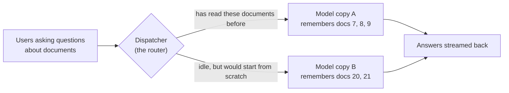

### What the project builds

1. **A router** (the dispatcher) that sits in front of several copies of a language model. It sends
   each request to the copy most likely to have already read the beginning of that request,
   without overloading anyone.
2. **A test bench** that replays 1,000 realistic document-question conversations with 8 to 64
   simultaneous users. It measures how quickly answers start, how smoothly they stream, and how
   many requests per second the system handles.
3. **A simulator** of an AI server, so the whole system can be developed and tested on a laptop
   without a GPU.

### What it found

On a real NVIDIA RTX A6000 GPU running two copies of a small open model (Qwen2.5-1.5B-Instruct,
served by vLLM), the cache-aware router was compared with handing requests out in simple
rotation (round-robin):

| | Cache-aware router vs simple rotation |
|---|---|
| Reading work the GPUs had to do | **36% less** |
| Avoidable re-reading eliminated | **77%** |
| Requests served per second at the same worst-case response time | **21% more** (±4%) |
| Time until the first word appears, typical request at peak load | **0.18 s instead of 0.28 s** |

These numbers come from 72 benchmark runs (72,000 requests, zero failures), each configuration
repeated three times.

There was also a surprise. With only two model copies, the simplest rule ("always send the same
conversation to the same copy") did even better. The smarter balancing pays off when there are
more copies, which the simulator shows with four. [Level 4](#45-what-the-results-mean) explains
why.

**A second experiment split the work across two GPUs.** One GPU (an NVIDIA A40) only reads
prompts, and the other only writes answers. This is "disaggregated serving", explained in
[2.8](#28-disaggregated-serving-briefly). It was compared with the ordinary setup on the same two
GPUs, where each GPU runs a complete copy of the model:

| | Split (read on one GPU, write on the other) vs a complete copy on each GPU |
|---|---|
| Requests served per second at the same worst-case response time | **59% fewer** (7.5 vs 18.1) |
| Time until the first word, typical request, 32 users | 1.9 s instead of 0.11 s |
| Time between words while the answer streams, 64 users | **2.4× faster** (9.8 ms vs 24 ms) |

- **The split kept writing fast and steady, as the design promises.**
- **On this hardware, the handoff was the problem.** After reading a prompt, the first GPU has to
  pass the prompt's memory to the second GPU, and that only ran at about 0.2 GB/s. It took 1–1.6
  seconds per request, compared with 0.1 seconds to read the prompt itself.
- **Beyond 32 users, the split setup broke down.** The writing GPU's memory filled up, requests
  hung for up to 15 minutes, and up to 64% of them failed. The project's fix was to make the
  router hold requests back while the writing GPU is full. With the fix, every request succeeded.

---

## Level 2: The concepts

### 2.1 Tokens

Language models don't read characters or whole words; they read **tokens**, which are pieces of
words. "Benchmarking" might be split into "Bench" + "mark" + "ing". In this project a typical
prompt is about 18,000 characters, or about **3,400 tokens**.

### 2.2 How a model answers: prefill, then decode

Generating an answer happens in two phases with very different performance characteristics.

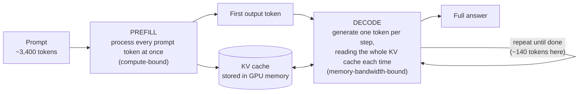

- **Prefill** reads the whole prompt in one big parallel computation. It is limited by the GPU's
  arithmetic throughput. Its duration largely sets **time to first token (TTFT)**, the wait
  before anything appears on screen.
- **Decode** produces the answer one token at a time. Each step is small, but it must read the
  model's weights and everything stored so far from GPU memory, so it is limited by memory
  bandwidth. Its speed sets **time per output token (TPOT)**, how smoothly the text streams.

Servers like vLLM and SGLang run many requests together in one batch (**continuous batching**).
A long prefill can share a GPU step with dozens of decodes, which slows those decodes down. This
**prefill–decode interference** comes up again later.

### 2.3 The KV cache

While processing each token, the model computes two vectors per layer, called the **key** and the
**value**. Every later token has to look back at all of them (this is *attention*), so they are
kept in GPU memory. That store is the **KV cache**.

It is large. For Qwen2.5-1.5B, each token needs

> 28 layers × 2 (key and value) × 2 KV heads × 128 dimensions × 2 bytes = **28 KiB**

so one 3,400-token prompt occupies about **93 MiB** of GPU memory.

### 2.4 Prefix caching: reusing what was already read

The key fact: **the KV entries for a token depend only on the tokens before it.** If two prompts
start with exactly the same text, their KV caches for that shared beginning (the **prefix**) are
identical. The second request can reuse the first one's entries and skip that part of prefill.

- **vLLM** splits the KV cache into blocks of 16 tokens. Each block is identified by a hash of its
  tokens *and* the hash of the block before it. A block can therefore be reused only if
  everything before it matches too.
- **SGLang** stores prefixes in a radix tree (RadixAttention).
- Both evict the **least recently used** entries when memory fills up.

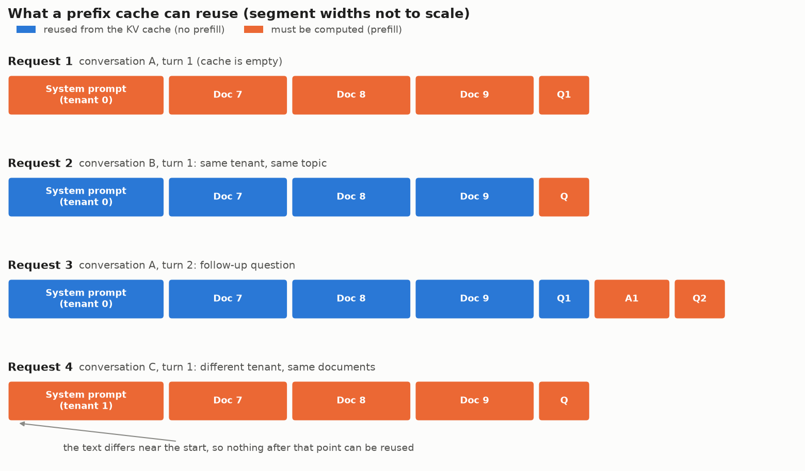

Reuse always stops at the **first difference**. Request 4 above contains exactly the same
documents as request 1, but its system prompt differs near the very start, so none of it can be
reused. That's why prompts are laid out with the most widely shared content first.

### 2.5 Why long-context RAG has so much reuse

**RAG** (retrieval-augmented generation) means a search system finds relevant documents and pastes
them into the prompt so the model can answer from them. A RAG chat prompt looks like this:

```
<system prompt: instructions for this application>     shared by every user of the app
### Retrieved context
[doc 7] ... [doc 8] ... [doc 9] ...                     shared by everyone asking about this topic
### Conversation
User: first question   Assistant: first answer          shared by later turns of this conversation
User: new question                                      unique
Assistant:
```

In the 1,000-prompt test workload, **81.3% of all prompt text repeats something that appeared
earlier**. That is the most any cache could possibly skip.

### 2.6 Why routing decides whether reuse happens

Each model copy (a **replica**, or **worker**) has its own KV cache. A cached prefix only helps a
request that is sent to the replica holding it.

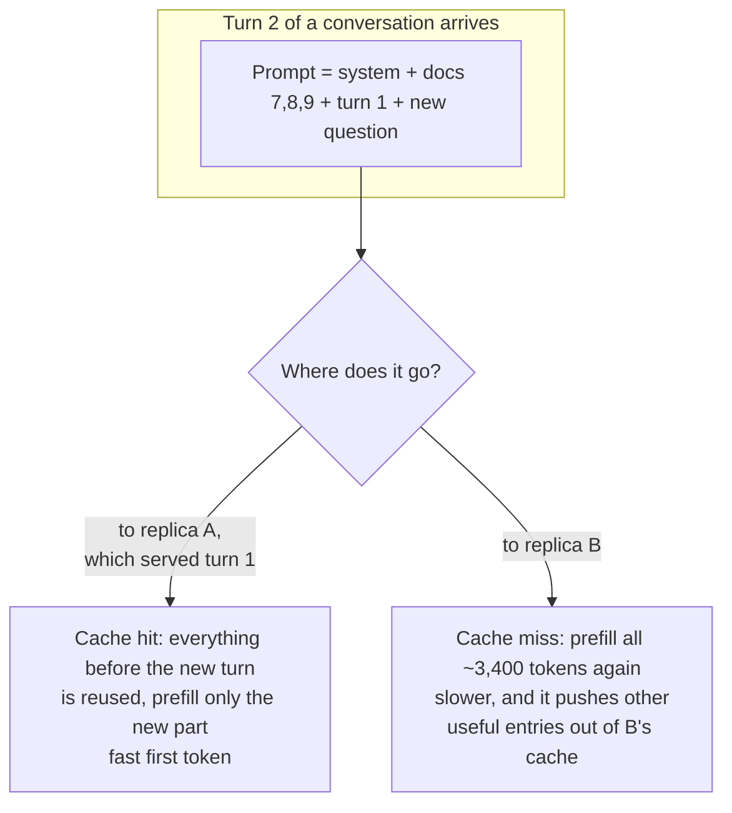

Round-robin alternates replicas, so a follow-up turn has only a 50% chance (with two replicas) of
landing where its earlier turns are cached. Pure "stickiness" fixes that, but popular topics then
pile onto one replica while the others idle. **The router's job is to trade cache locality
against load balance.**

### 2.7 How "fast" is measured

| Metric | Meaning | What a user feels |
|---|---|---|
| **TTFT** (time to first token) | Request sent → first token received | The pause before the answer starts |
| **TPOT** (time per output token) | Average gap between output tokens | How smoothly text streams |
| **E2E** (end-to-end latency) | Request sent → last token received | Total wait for the full answer |
| **Throughput** | Completed requests per second | How many users the hardware can serve |
| **p50 / p95** | The median, and the value 95% of requests beat | Typical experience / bad-day experience |

Tail latency (**p95**) matters because services promise response times to *most* users, not just
the median one.

**Throughput at matched latency** is the fair way to compare systems. You can always squeeze more
throughput out of a server by letting requests wait longer. So the question is: **with the same
latency budget, how many more requests per second does policy X handle than policy Y?** That is
the "+21%" in the results.

### 2.8 Disaggregated serving, briefly

Because prefill and decode interfere when they share a GPU, a newer design gives them **separate
GPU pools**:

- *prefill workers* process prompts and then hand the KV cache over the network;
- *decode workers* generate the tokens.

This removes the interference. The costs are the KV transfer and the need to pick the right
prefill-to-decode ratio. The project supports this mode (using vLLM's NixlConnector protocol),
studies it in the simulator, and measures it on two real GPUs
([4.6](#46-disaggregated-prefilldecode)).

---

## Level 3: How it is built

This level opens up the **router**, the part that makes the decisions, by following one
request from the moment it arrives to the moment its answer finishes. Each step starts with the
idea in plain words and a small example, then names the technical term and the code file. The
fine print sits in folded **More detail** sections; skip them on a first read.

### 3.1 The pieces, and who talks to whom

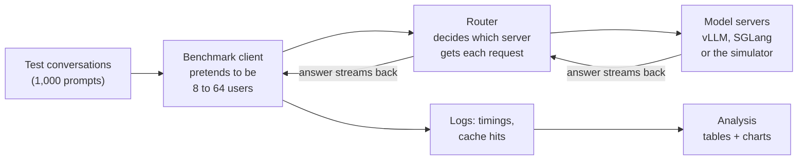

| Piece | Its job, in one sentence | Code |
|---|---|---|
| Test conversations | A fixed, repeatable set of realistic document-question conversations | `src/kvbench/workload/` |
| Benchmark client | Plays the users: sends each conversation's questions in order and times every answer | `src/kvbench/bench/` |
| **Router** | Sits between users and servers and picks a server for every request | `src/kvbench/router/` |
| Model servers | Run the language model. Real ones are vLLM or SGLang on a GPU; the simulator is a stand-in for laptops | `src/kvbench/sim/` |
| Analysis | Turns the logs into the report, tables and charts | `src/kvbench/analysis/` |

Everything talks over ordinary HTTP, in the same format OpenAI's API uses. That's why the same
router and client work unchanged against the simulator on a laptop and against vLLM on a GPU.

### 3.2 Following one request through the router

**The example.** There are two model servers, **A** and **B**. A few seconds ago, server A
answered the first turn of a conversation about billing. Now the user asks a follow-up question.
The new prompt is about 18,000 characters: the app's instructions, three billing documents, the
first question and answer, and the new question.

The router handles it in five steps:

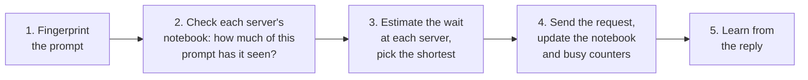

#### Step 1: Fingerprint the prompt

**The idea.** The router needs a quick way to ask "has a server already seen the beginning of
this prompt?" Comparing 18,000 characters against everything it ever sent would be slow. So it:

1. cuts the prompt into **pieces of 256 characters** (the example prompt makes 70 pieces);
2. gives each piece a short **ID number**, computed from the piece's text.

**The trick.** Each piece's ID is computed from its own text *and the previous piece's ID*. So
the ID of piece 5 doesn't just stand for piece 5. It stands for "exactly these first five pieces,
in this order". Two prompts that begin the same way get the same IDs up to the first
difference, and different IDs from then on, even where their later text is identical.

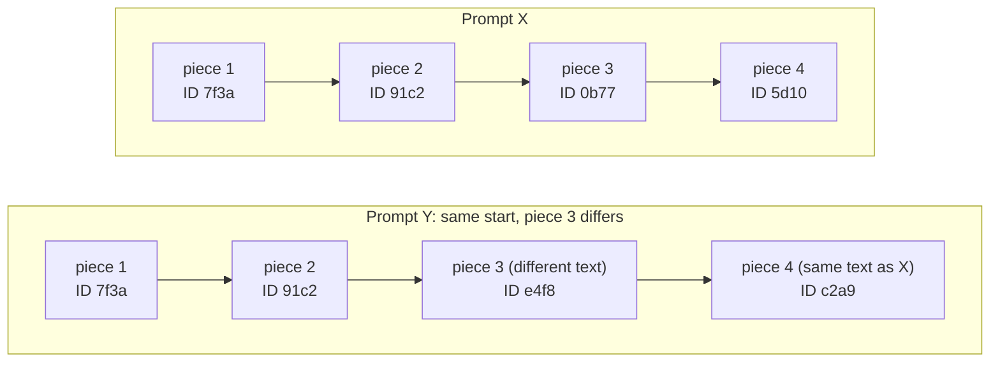

*(The IDs are made up for illustration.)* Pieces 1–2 match. From piece 3 on, every ID differs,
including piece 4, whose text is identical to X's. That matches how a real KV cache behaves:
reuse stops at the first difference ([2.4](#24-prefix-caching-reusing-what-was-already-read)).

**Technical name:** chained hashing (BLAKE2b, 8-byte IDs). **Code:** `chunk_hashes()` in
`src/kvbench/common/prefix.py`.

<details>
<summary>More detail</summary>

- Formally: `h0 = H(model name + piece 0)`, then `h_i = H(h_(i−1) + piece i)`. Including the
  model name keeps two models' prefixes from ever matching each other.
- vLLM identifies its 16-token KV blocks the same way, by chaining each block's hash with its
  parent's. The router works on characters rather than tokens, so it doesn't need the model's
  tokenizer. SGLang's router makes the same trade-off.
- A final piece shorter than 256 characters gets no ID: like a partly filled KV block, it can't
  be shared.

</details>

#### Step 2: Check each server's notebook

**The idea.** The router can't look inside a server's memory. Instead it keeps a **notebook for
each server**, listing the IDs of every piece it has sent there. To guess how much of the new
prompt a server already has, it reads the prompt's IDs from the start and counts how many are in
that server's notebook, **stopping at the first one that's missing**.

In the example:

| | IDs found in the notebook (from the start) | Router's guess |
|---|---|---|
| Server A | 67 of 70: it saw everything up to the new turn | 96% of this prompt is cached on A |
| Server B | 8 of 70: it has seen this app's instructions, but not these documents | 11% cached on B |

A notebook can only hold as much as the server's memory, which here is 2,048 pieces. When it's
full, the entries **used longest ago are forgotten first**, which is roughly what the server does
with its own memory.

**Technical name:** the per-worker prefix index. **Code:** `PrefixIndex` in
`src/kvbench/router/index.py`.

<details>
<summary>More detail</summary>

- **Capacity:** 131,072 tokens of KV memory × 4 characters per token ÷ 256 characters per piece =
  2,048 pieces per server. Eviction is least-recently-used (LRU).
- **Insertion order:** a prompt's IDs are written last-to-first. That makes the shared beginning
  the most recently used part, so it is forgotten last, as in the real engines.
- **Expiry:** entries untouched for 600 s are treated as gone.
- **Reset:** a notebook is wiped when its server's cache is flushed, when the server restarts
  (its statistics counters jump backwards), or when it stops answering health checks.
- **It's only a guess.** The server may already have evicted something the notebook still
  lists. Step 5 measures how good the guesses are.

</details>

#### Step 3: Estimate the wait at each server and pick the shortest

**The idea.** For each server the router now knows two things:

- how much of this prompt it probably has cached (step 2);
- how busy it is. This number is exact, because every request passes through the router, so it
  counts what each server is still working on.

The `cache_aware` policy combines both into one number, **"roughly how many seconds until this
request's first token if I send it there?"**, and picks the server with the smallest estimate:

```
estimated wait =  (reading already queued on that server + the part of this prompt it must read)
                     ÷ reading speed (20,000 tokens/s)
                + 5 ms for every answer that server is currently writing
                + a large penalty if its memory is more than 90% full
```

**In the example**, the router estimates the prompt at 4,500 tokens (it uses
characters ÷ 4):

| | Must read | Reading already queued | Answers being written | Estimated wait |
|---|---:|---:|---:|---|
| Server A | 4% of 4,500 ≈ **190** tokens | 2,000 tokens | 30 | (2,000 + 190) / 20,000 + 30 × 0.005 = **0.26 s** |
| Server B | 89% of 4,500 ≈ **3,990** tokens | 0 tokens | 24 | (0 + 3,990) / 20,000 + 24 × 0.005 = **0.32 s** |

**A wins**, even though it's busier, because reading 190 tokens instead of 3,990 saves more time
than A's extra queue costs.

Now suppose A had been swamped, with 6,000 tokens of reading already queued. Its estimate would
be (6,000 + 190) / 20,000 + 0.15 = 0.46 s, and **B would win**. That trade-off between "has the
data" and "is free" is the whole point of the policy.

**Safety net.** If one server has more than 8 extra requests in progress *and* 1.5× as many as
the least busy one, the router skips the formula and sends the request to the least busy server.

**The other policies** compared in the experiments are simpler:

| Policy | How it chooses, in plain words |
|---|---|
| `round_robin` | Take turns: A, B, A, B, ... |
| `least_loaded` | Whichever server has the fewest requests in progress |
| `prefix_affinity` | Look only at the first 16 pieces (about 4,000 characters: the app's instructions and the start of the first document) and always send that beginning to the same server |
| `cache_aware` | The estimated-wait formula above |

**Code:** `src/kvbench/router/policies.py`.

<details>
<summary>More detail</summary>

- The formula exactly:
  `cost(w) = (pending_prefill_tokens + P × (1 − m)) / prefill_tps + decode_cost_s × decode_inflight + mem_penalty_s × max(0, kv_usage − 0.9) / 0.1`,
  with `prefill_tps` = 20,000, `decode_cost_s` = 0.005 and `mem_penalty_s` = 1.0
  (`configs/router/vllm.yaml`).
- **Ties** (for example, at the start when every server is idle and every notebook is empty) go to
  the server with fewer requests in progress, then to the one with the emptier notebook. That
  spreads *new* prefixes across servers instead of piling them all onto server A.
- **Memory use** comes from each server's own statistics, which the router fetches every 0.5 s
  (`/metrics`). The busy counts come from the router's own bookkeeping, which is always current.
- `prefix_affinity` uses **rendezvous hashing**. Each server computes a score from (prefix ID,
  server name) and the highest score wins. The same prefix therefore always lands on the same
  server, and only about 1/N of prefixes move if a server is added.
- A fifth policy, `weighted`, adds 0.5 × cache-hit fraction − 0.3 × queue − 0.2 × memory. It's
  easy to explain, but the three terms have no common unit, so the weights are arbitrary. That's
  why `cache_aware` measures everything in seconds instead.

</details>

#### Step 4: Send the request and update the notebook right away

The router forwards the request to server A. At the same moment it:

- **writes the prompt's 70 IDs into A's notebook**, without waiting for the answer to finish. If
  ten requests with the same new documents arrive within one second, they should all follow the
  first one to A, instead of each making a different server read the same documents;
- **adds the request to A's busy counters**: one more request in progress, and about 190 more
  tokens of reading queued.

The answer then streams from A, through the router, back to the user. The router adds a few
labels to the reply (which server, and why), so the benchmark can record every decision.

#### Step 5: Learn from the reply

- **First word arrives:** A has finished reading the prompt, so the router removes those 190
  tokens from A's "reading queued" counter.
- **Last word arrives:** the server's final message reports how many prompt tokens it *actually*
  found in memory. The router compares that with its 96% guess and keeps a running score of how
  accurate each notebook is. Then it lowers A's "in progress" count.

The whole journey, as a timeline:

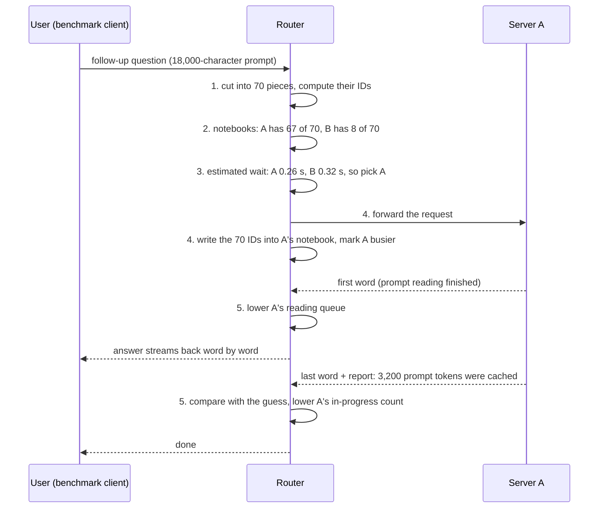

<details>
<summary>More detail: the code names for these steps</summary>

- Steps 3–5 are handled by a `Lease` object in `src/kvbench/router/app.py`.
- `Lease.accepted()` writes the notebook (the index). `first_token()` releases the queued
  prefill estimate. `feedback()` compares predicted vs reported cached tokens. `release()`
  decrements in-flight.
- Busy counters: `inflight`, `prefill_inflight` (requests still reading) and
  `pending_prefill_tokens`. Requests still writing = `inflight − prefill_inflight`.
- Reply labels: `x-kvbench-worker`, `x-kvbench-reason`, `x-kvbench-matched-chunks`,
  `x-kvbench-prompt-chunks`.
- vLLM leaves out the cached-token field entirely when nothing was cached. The router treats
  that as 0 once a server has reported the field at least once.
- Optional: with `adaptive_capacity` on, a server whose notebook keeps over-promising gets its
  notebook capacity shrunk.

</details>

### 3.3 The test conversations

**The idea.** To compare routing rules fairly, every run must replay *exactly the same*
conversations. The project generates them from a fixed random seed, imitating an imaginary
company's document-chat service:

- **3 apps**, each with its own instructions (150–400 words). Everyone using an app shares this
  opening.
- **60 topics × 6 documents** (300–900 words each). A few topics are very popular and most are
  rare. This popularity pattern is called a Zipf distribution; real traffic has it too.
- Each conversation picks an app and a topic, and "retrieves" **3–5 documents**. 70% of the time
  that's the topic's standard top documents in the standard order, so they share a prefix with
  other conversations on that topic. 30% of the time it's a shuffled mix, so they share less.
- Conversations last **about 3 turns** (at most 8). Each turn's prompt repeats everything before it
  and adds the new question.
- Answer lengths are fixed per request (median 128 tokens), so every routing rule does exactly the
  same writing work.

The result is **1,000 prompts in 369 conversations**, averaging 18,047 characters (about 3,360
tokens). At most **81.3%** of all prompt text could be served from a cache.

The document text itself is random words. The *pattern* of sharing is realistic; the content
isn't ([limitations](#47-limitations-and-threats-to-validity)).

**Code:** `src/kvbench/workload/rag.py`. The prompt layout and the reuse figure are in
[2.4](#24-prefix-caching-reusing-what-was-already-read)–[2.5](#25-why-long-context-rag-has-so-much-reuse).

### 3.4 The practice server (simulator)

**The idea.** Renting a GPU costs money by the hour. So the router and the benchmark were built
and tested against a **pretend model server** that runs on a laptop. It looks exactly like vLLM
from the outside, with the same web addresses and statistics names. Inside, it doesn't run a
model; it follows the same *rules* a real server does:

- **Memory:** a fixed amount of KV memory in 16-token blocks, with prefix caching. Cached blocks
  are reused, and the oldest unused ones are thrown out when space runs out.
- **Work in rounds:** in each round it lets in new requests if memory allows, and gives every
  request that's writing one more word. Leftover capacity in the round goes to reading prompts.
- **Pretend time:** it works out how long that round would take on a real GPU using a simple
  formula, waits that long, and moves on.

Because reading and writing share rounds, a big reading job slows down everyone's writing. That's
the same interference real servers have ([2.2](#22-how-a-model-answers-prefill-then-decode)).

The simulator gets the *relative* costs roughly right (reading vs writing, cache hit vs miss),
not the exact numbers a real GPU would produce.

**Code:** `src/kvbench/sim/`.

<details>
<summary>More detail</summary>

- **Scheduler loop:** admit (first-come first-served, while sequence slots and KV blocks are
  free) → schedule (a token budget of 2,048 per step: every decoding sequence gets 1 token, and
  prefill chunks get the rest) → cost → apply.
- **Step time** = 2 ms + prefill tokens / 10,000 tokens/s + 8 ms (weights read, if anything is
  decoding) + 30 ns × total context tokens + 0.05 ms per decoding sequence.
- **Disaggregated mode:** it uses the same `kv_transfer_params` protocol as vLLM, with a
  simulated KV transfer link (25 GB/s, 2 ms latency).
- **Speed setting:** `speed` makes simulated time run faster for quick experiments. Ratios
  between policies are preserved.

</details>

### 3.5 How a benchmark run works

**The idea.** The benchmark client pretends to be *N* users (8, 16, 24, 32, 48 or 64). Each
pretend user:

1. takes the next conversation from a shared pile;
2. sends its turns one at a time, waiting for each answer before asking the next question, like
   a real person;
3. moves on to the next conversation when that one is finished.

This is called a **closed loop**. A **run** is one routing rule at one number of users. Before
every run, everything is reset so each rule starts from the same blank state:

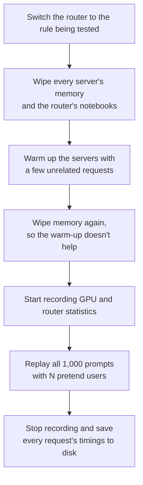

The full experiment is 4 rules × 6 user counts × 3 repeats = **72 runs**. The order of the rules
is shuffled each time, so a slow change in the cloud machine (heat, noisy neighbors) can't
favor one rule.

For each request, the client records:

- when the first word arrived;
- the gaps between words;
- when the last word arrived;
- how many prompt tokens the server found cached;
- which server the router picked.

**Code:** `src/kvbench/bench/`.

### 3.6 Turning the logs into the report

`kvbench analyze` reads the saved logs. For each run it computes:

- the latency percentiles;
- the throughput;
- how much prefill work was done and how much of it was avoidable;
- how evenly the servers were loaded.

It then averages across the 3 repeats (with confidence intervals) and writes `REPORT.md`,
CSV tables and the charts used in Level 4.

**Code:** `src/kvbench/analysis/`.

### 3.7 Optional: disaggregated mode

In disaggregated mode ([2.8](#28-disaggregated-serving-briefly)), one request makes two stops:

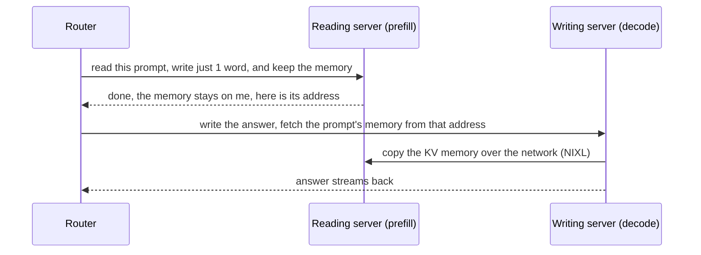

- Prefix caching lives on the **reading** servers, so that's where the cache-aware rule is
  applied.
- The writing server is simply the least busy one.
- Both stops carry the **same request ID**. When the writing server has copied the memory, it
  tells the reading server "done with request X" so that server can free it. If the IDs
  differed, the reading server would hold every request's memory for two minutes and quickly
  run out.
- This follows vLLM's NixlConnector protocol: the request carries `kv_transfer_params`,
  `max_tokens = 1` for the reading step, `do_remote_decode = true`, and a shared `X-Request-Id`
  header.

**Admission control: don't start what can't be finished.** The writing server holds the memory of
every conversation it is answering, so it can only take so many at once. On real GPUs, sending it
more than about 32 at once filled its memory and stalled everything ([4.6](#46-disaggregated-prefilldecode)).
So the router reserves a place on the writing server *before* the reading step starts. When all
places are taken, the request waits in line at the router:

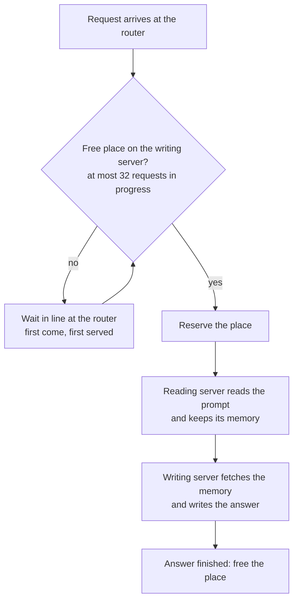

The point is the order. A request waiting at the router holds no GPU memory anywhere. A request
admitted too early would have its prompt read, and its memory parked on the reading server, with
no writing server ready to take it. The limit is set per decode worker (`max_inflight`). Places are
also released when a request fails or is cancelled, so a broken request can't hold one forever.

**Code:** `_handle_disagg()` and `_admit_decode()` in `src/kvbench/router/app.py`.

### 3.8 Tests

There are 43 automated tests (`make test`, about 10 seconds, no GPU needed):

- **Small tests** check each part on its own: the IDs, the notebooks, every routing rule, the
  simulator's memory, and the report math.
- **End-to-end tests** start a real router and simulated servers and send requests through them.

---

## Level 4: Measurement and results

### 4.1 Experimental setup (real GPU)

| | |
|---|---|
| Hardware | 1× NVIDIA RTX A6000 (48 GB), RunPod |
| Engine | vLLM 0.11.0, prefix caching on, `--enable-prompt-tokens-details` |
| Model | Qwen2.5-1.5B-Instruct, **2 replicas on the same GPU** (`--gpu-memory-utilization 0.40` each) |
| KV cache per replica | Capped at **8,192 blocks = 131,072 tokens (≈ 3.5 GiB)** using `--num-gpu-blocks-override` |
| Other engine limits | `--max-model-len 16384`, `--max-num-seqs 64` |
| Router | `cache_aware` parameters as in [3.2, step 3](#step-3-estimate-the-wait-at-each-server-and-pick-the-shortest), same host |
| Workload | The 1,000-prompt trace above, identical for every run |
| Sweep | 4 policies × concurrency {8, 16, 24, 32, 48, 64} × 3 repeats = 72 runs, 72,000 requests |
| Duration and errors | 3.4 hours of benchmarking, **0 failed requests** |

**Why cap the KV cache?** Uncapped, each replica could hold most of the working set, every policy
would hit close to the 81% ceiling, and routing wouldn't matter. With the cap:

- one replay contains about 627,000 tokens of *distinct* prefix content;
- the two replicas together can hold only 262,144 tokens;
- so caches must evict, and routing decides what survives.

That is the regime a production system is in with bigger models, longer contexts, or more traffic.

**Why a 1.5B model?** It saturates the GPU within the tested range. Under round-robin, p95 E2E
latency climbs from 5.1 s at 8 sessions to 16.7 s at 64, while throughput flattens at about 7.8
requests/s. A matched-latency comparison only means something on a saturating curve.

### 4.2 Methodology controls

- **Identical work.** Every run replays the same prompts with the same output lengths
  (`ignore_eos` with fixed `max_tokens`, temperature 0).
- **Cold start.** Before every run, engine prefix caches are flushed (`POST /reset_prefix_cache`,
  enabled by `VLLM_SERVER_DEV_MODE=1`) and the router index is cleared.
- **Warm-up excluded.** Short unrelated prompts warm the engine, then the cache is flushed again.
- **Order randomized.** Policy order is shuffled within each (repeat, concurrency) block.
- **Repeats and uncertainty.** There are 3 repeats per point, and tables show the mean ± a 95%
  confidence interval (Student's *t*).
- **Steady-state throughput.** This counts completions between the 10th and 90th percentile
  completion times. That excludes the ramp-up at the start of a closed-loop run and the drain at
  the end.

### 4.3 Metric definitions and how the accounting was checked

**Prefill accounting.** Each policy's prefill work is compared with two references.

- **Computed prefill tokens** = Σ (prompt tokens − cached tokens), from each engine's own
  `usage.prompt_tokens_details.cached_tokens`.
- **Ideal prefill** = what a single *infinitely large* cache would still have to compute. This is
  the number of distinct 256-char chunks in the trace, converted to tokens using the measured
  tokens-per-character ratio.
- **Redundant prefill** = computed − ideal. This is the work a perfect router with unlimited
  memory would avoid. Reduction percentages are reported for both total and redundant prefill.
  These are *token* counts, not GPU-time savings.

**Cross-check.** The prefill numbers depend on the cached-token counts reported per request.
Those were checked against vLLM's independent Prometheus counters (`prefix_cache_queries` /
`prefix_cache_hits`). **The two agree within 0.07 percentage points in all 72 runs.**

Getting there required fixing a subtle bug. vLLM *omits* `prompt_tokens_details` entirely when a
request had zero cached tokens, instead of reporting 0. The first version of the analysis treated
"missing" as "unknown" and dropped those requests. That silently removed exactly the cold misses
and inflated hit rates. Now, if a backend reports cached tokens for any request in a run, a missing
value counts as 0. A regression test covers it.

**Matched-latency throughput:**

1. For each policy, plot steady-state throughput against p95 E2E latency across the concurrency
   levels.
2. Pick a latency target *T*. By default *T* is the **baseline's p95 at its highest concurrency**:
   the tail latency round-robin needed to carry its peak load.
3. For each policy, find the highest throughput whose p95 is ≤ *T*, interpolating linearly between
   adjacent concurrency points.
4. Report the gain over the baseline at the same *T*, as the mean curve and as the mean ± CI of
   per-repeat gains.

Two flags guard against misleading numbers:

- **`lower bound`**: the policy never got as slow as *T* at any tested concurrency, so its true
  throughput at *T* is at least the reported value.
- **`flat region`**: *T* falls where latency barely changes with load (elasticity < 0.25). There,
  tiny latency differences turn into huge throughput differences. An early simulator analysis
  placed *T* in such a region and produced a meaningless "+101%". That is why the default target
  moved to the baseline's peak-load latency, and why the flag exists.

### 4.4 Results

**Headline table** (prefill summed over all concurrency levels; mean of 3 repeats):

| Policy | Prompt tokens served from cache | Prefill tokens computed | vs round-robin | Redundant prefill vs round-robin | Throughput at p95 E2E ≤ 16.70 s | vs round-robin |
|---|---:|---:|---:|---:|---:|---:|
| `round_robin` | 64.7% | 7.12 M | — | — | 7.84 req/s | — |
| `least_loaded` | 73.9% | 5.25 M | −26.2% | −55.6% | ≥ 9.25 req/s | **+18.2% ± 3.2%** |
| `cache_aware` | 77.4% | 4.54 M | **−36.2%** | **−76.7%** | ≥ 9.49 req/s | **+21.2% ± 4.1%** |
| `prefix_affinity` | 79.5% | 4.12 M | −42.1% | −89.3% | ≥ 10.06 req/s | **+28.5% ± 6.3%** |
| *infinite cache (ideal)* | *81.3%* | *3.76 M* | | | | |

"≥" marks a lower bound: none of the three policies reached 16.70 s even at 64 sessions.

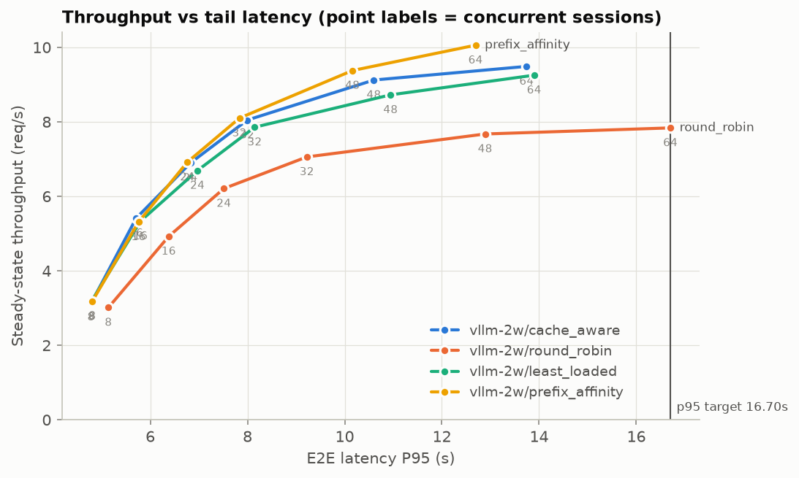

*Each point is one concurrency level, labeled with the number of sessions. Up and to the left is
better. Round-robin flattens out first; the vertical line is the matched-latency target.*

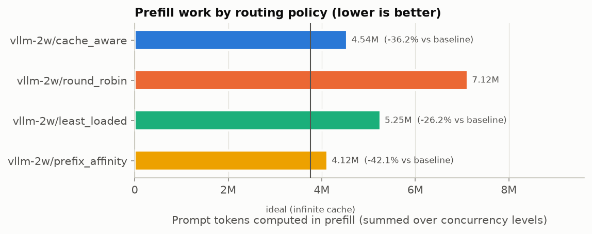

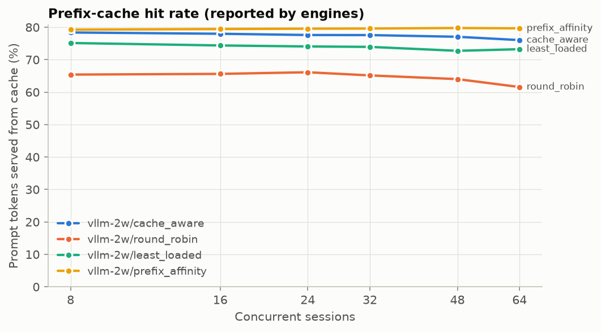

**At peak load (64 concurrent sessions):**

| Policy | TTFT p50 | TTFT p95 after start-up* | TPOT p50 | TPOT p95 | E2E p95 | Throughput |
|---|---:|---:|---:|---:|---:|---:|
| `round_robin` | 0.275 s | 0.673 s | 54.2 ms | 81.0 ± 16.7 ms | 16.70 ± 2.34 s | 7.84 req/s |
| `least_loaded` | 0.204 s | 0.539 s | 46.9 ms | 59.7 ms | 13.90 s | 9.25 req/s |
| `cache_aware` | **0.175 s** | **0.462 s** | 46.4 ms | 57.7 ms | 13.74 s | 9.49 req/s |
| `prefix_affinity` | 0.186 s | 0.489 s | **43.3 ms** | **56.1 ms** | **12.69 s** | **10.06 req/s** |

\* Requests started in the first 15 s of the run are excluded. Including them, TTFT p95 is about
1.8–1.9 s for every policy, for the reason explained in point 6 below.

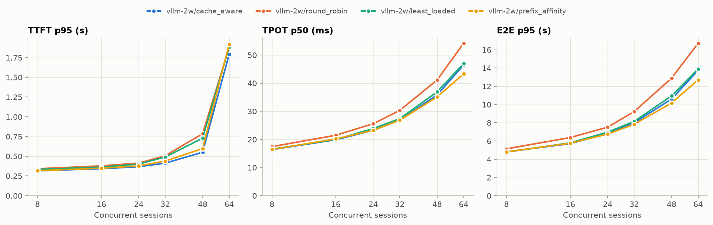

### 4.5 What the results mean

**1. Cache-aware routing cuts prefill work, consistently.** `cache_aware` computes 33.9%–37.6%
fewer prefill tokens than round-robin at *every* concurrency level, and removes about three
quarters of the redundant prefill.

**2. Less prefill also makes decoding faster.** At 64 sessions, TPOT p95 drops from 81.0 ms to
57.7 ms (−29%), even though routing does nothing to decode directly. With chunked prefill, prompt
chunks share GPU steps with decoding sequences, so every prefill token avoided makes those steps
shorter. That's the prefill–decode interference from [2.2](#22-how-a-model-answers-prefill-then-decode),
showing up in real measurements.

**3. Round-robin still gets 65% cache hits.** It isn't starting from zero:

- the three system prompts and the most popular documents end up cached on *both* replicas;
- with two replicas, a follow-up turn lands on the replica holding its earlier turns half the time.

The routing gains come from what is left: the conversation history, and the less popular
documents that don't fit in both caches at once.

**4. Round-robin balances request counts, not memory.** The per-replica KV usage below shows
round-robin at one point running one replica at about 98% of its KV cache while the other sat near 25–30%.
Near-full caches force evictions (and, in vLLM, preemptions). That explains round-robin's noisy
tail, with a TPOT p95 confidence interval of ±16.7 ms. The cache-aware policies keep both replicas
in a narrow band.

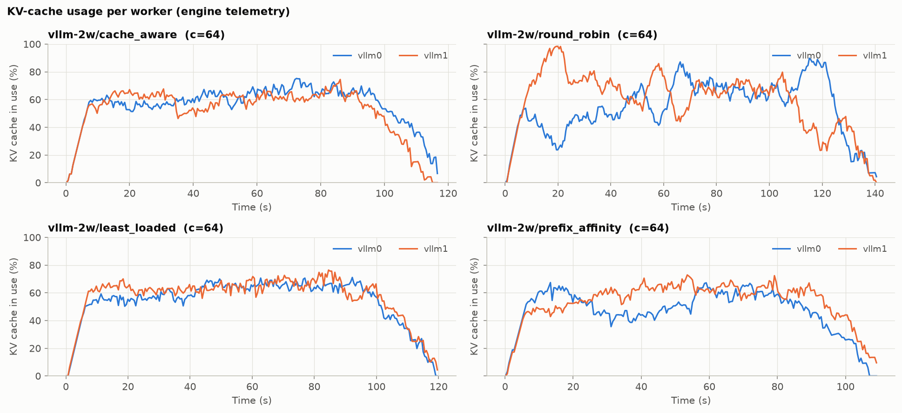

**5. With two replicas, simple prefix affinity won, and the reason matters.** `prefix_affinity`
reached a 79.5% hit rate, close to the 81.3% ceiling. Its load imbalance was 1.09: one replica
handled about 54.5% of requests, the other 45.5%.

`cache_aware` deliberately gives up some locality for balance: imbalance 1.02, hit rate 77.4%. With
only two replicas, a 9% imbalance costs less than the extra cache misses, so pure affinity comes
out ahead.

Hotspots get worse as the number of workers grows and popularity gets more skewed. The simulator,
with four workers, shows the crossover:

| Simulator, 4 workers, 64 sessions | Load imbalance | p95 E2E | Matched-latency throughput vs round-robin |
|---|---:|---:|---:|
| `prefix_affinity` | **1.40** | 3.06 s | +16.9% |
| `cache_aware` | 1.12 | **2.16 s** | **≥ +37.8%** |

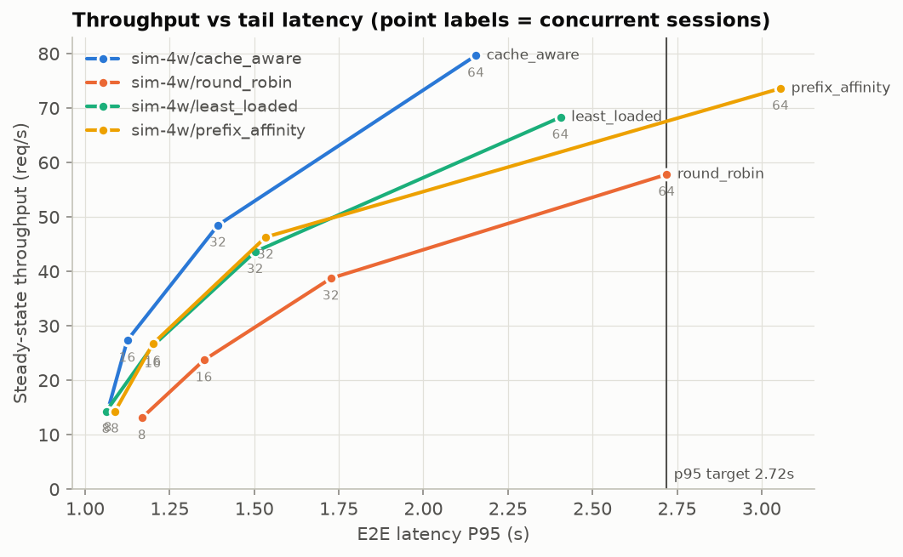

*In the 4-worker simulation, `prefix_affinity`'s hottest worker becomes the bottleneck at 64
sessions: its curve bends right, past the round-robin target. `cache_aware` keeps scaling.
Simulator numbers are relative, from 400 prompts and one repeat.*

The honest summary: **pure affinity is the right choice when the replica count is small and load
is fairly even, and cost-based balancing pays off as the cluster grows.** Confirming that crossover
on real GPUs (4+ replicas) is the most valuable next experiment.

**6. Tail TTFT at 64 sessions is a start-up effect.** All 64 sessions send their first request in
the same second, and all of them are cold (empty cache), so roughly 200,000 prompt tokens hit two
replicas at once. Requests started in that first second waited about 3.7 s for their first token
under every policy, which sets the p95 for the whole run. Excluding the first 15 s, TTFT p95 is
0.46 s for `cache_aware` vs 0.67 s for round-robin (−31%). An open-loop arrival pattern, or
staggered session starts, would remove this artifact.

**7. GPU memory is flat by design.** NVML reports a constant 15.7–15.9 GiB within every run, because
vLLM pre-allocates its KV pool at start-up. The useful memory signal is the engine's KV-usage
percentage (the chart above), not the process's memory footprint.

### 4.6 Disaggregated prefill/decode

#### On two real GPUs

**Setup.**
- **Hardware:** RunPod, 2× NVIDIA A40 (48 GB, PCIe 4.0, no NVLink).
- **Software:** vLLM 0.11.0 with NIXL 0.6.0.
- **Same as [4.1](#41-experimental-setup-real-gpu):** the model (Qwen2.5-1.5B-Instruct), the
  1,000-prompt trace, and the `cache_aware` router.
- **Same engine settings for every server:** a KV cache of 8,192 blocks (131K tokens),
  `--max-num-seqs 64`, `--max-model-len 16384`.

Three configurations:

| Configuration | GPU 0 | GPU 1 | Runs |
|---|---|---|---|
| **Colocated** (`vllm-2gpu-2w`) | complete replica | complete replica | 8–64 sessions × 3 repeats |
| **1P+1D** (`vllm-disagg-1p1d`) | prefill | decode | 8–64 sessions × 3 repeats |
| **1P+1D, capped** (`vllm-disagg-1p1d-ac32`) | prefill | decode; the router admits at most 32 requests at a time | 48 and 64 sessions × 2 repeats |

> **The KV transfer path.** The KV cache goes from GPU 0 to GPU 1 *through host memory*: NIXL
> over UCX with `UCX_TLS=tcp,cuda_copy`. The direct path, where the decode GPU reads the prefill
> GPU's memory peer-to-peer (UCX `cuda_ipc`), took the decode GPU offline within about 30 s of
> load. It showed `ERR!` in `nvidia-smi`, on two hosts whose GPUs sit behind PCIe bridges.
> Everything below is measured on the staged path. Procedure: [RUN_DISAGG_2GPU.md](RUN_DISAGG_2GPU.md).

**Throughput** (requests per second, steady state; mean of the repeats):

| Sessions | Colocated | 1P+1D | 1P+1D, capped |
|---:|---:|---:|---:|
| 8 | **5.82** | 4.37 | |
| 16 | **9.86** | 6.57 (0.07% errors) | |
| 24 | **12.72** | 7.43 (0.07% errors) | |
| 32 | **14.75** | 7.71 | |
| 48 | **16.91** | collapsed: 25% errors | 4.98 (0 errors) |
| 64 | **18.09** | collapsed: 64% errors | 2.85 (0 errors) |

At a matched p95 end-to-end latency of 7.15 s, colocated serves 18.09 req/s and 1P+1D serves
7.49 req/s: **59% less** (−58.5% ± 3.6% per repeat). Colocated had zero errors in all 18,000
requests.

**Latency** (medians; for 1P+1D at 48 and 64 sessions, the capped runs):

| Sessions | TTFT p50, colocated | TTFT p50, 1P+1D | TPOT p50, colocated | TPOT p50, 1P+1D |
|---:|---:|---:|---:|---:|
| 8 | **0.079 s** | 0.326 s | **8.9 ms** | 9.5 ms |
| 16 | **0.089 s** | 0.663 s | **10.6 ms** | 11.0 ms |
| 24 | **0.095 s** | 1.193 s | 12.4 ms | **12.3 ms** |
| 32 | **0.106 s** | 1.901 s | 14.4 ms | **13.1 ms** |
| 48 | **0.124 s** | 4.92 s | 19.1 ms | **11.5 ms** |
| 64 | **0.148 s** | 20.7 s | 24.0 ms | **9.8 ms** |

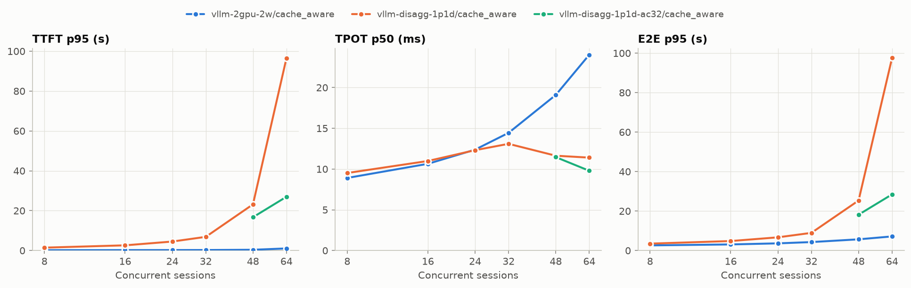

*The three lines are colocated (blue), 1P+1D (orange) and 1P+1D with the admission cap (green).
Orange shoots up at 48 and 64 sessions where it collapsed; green is the same setup with the cap.*

**What the real-GPU results mean**

**1. Disaggregation delivered its promise for decode.** TPOT stays at 9.5–13 ms at every load,
because the decode GPU never processes a prompt. Colocated TPOT rises from 8.9 ms to 24 ms as
prompt chunks share more decode steps (the interference from [2.2](#22-how-a-model-answers-prefill-then-decode)).
Past 32 sessions, the split streams tokens 1.7–2.4× faster.

**2. On this hardware, the KV handoff is the bottleneck.** The router timestamps each request's
stages, which splits TTFT into its parts (first repeat):

| Run | TTFT p50 | Waiting in the router | Prefill | KV handoff + first token |
|---|---:|---:|---:|---:|
| 1P+1D, 24 sessions | 1.16 s | 0 | 0.10 s | 1.04 s |
| 1P+1D, 32 sessions | 1.78 s | 0 | 0.10 s | 1.65 s |
| capped, 48 sessions | 5.27 s | 2.43 s | 0.10 s | 2.40 s |
| capped, 64 sessions | 20.99 s | 11.14 s | 0.15 s | 10.41 s |

The prefill itself takes 0.1 s. The handoff takes more than 10 times longer. The volume of KV moved can be
read from the decode engine's counters: prompt tokens minus the tokens it already had in its own
prefix cache, times 28,672 bytes per token (28 layers × 2 KV heads × 128 dimensions × K and V × 2
bytes). It works out to:

| | 8 sessions | 24–32 sessions | capped, 48 | capped, 64 |
|---|---:|---:|---:|---:|
| Decode GPU's own prefix-cache hit | 76% | 74–75% | 59–61% | 31–32% |
| KV pulled per request | 24 MB | 24 MB | 38–40 MB | 66–67 MB |
| Average transfer rate | 100 MB/s | 164–172 MB/s | 191 MB/s | 197–199 MB/s |

The rate levels off just under **0.2 GB/s**. That is more than 100× below what a PCIe 4.0 ×16 link
can carry (about 32 GB/s each way), and the simulator had assumed 25 GB/s. As load rises, the
decode GPU's memory fills with running requests, so it keeps fewer conversation histories cached.
That means more KV to pull per request, through the same narrow pipe. The arithmetic matches the
measurements: 0.2 GB/s ÷ 66 MB per request ≈ 3.0 req/s predicted at 64 sessions, against 2.85
measured.

**3. Without admission control, overload causes a collapse, not a slowdown.** Peak KV usage on the
decode GPU was:
- 22–23% at 8 sessions;
- 38–42% at 16;
- 57–61% at 24;
- 75–77% at 32;
- **100%** at 48 and 64.

Once it was full, a chain reaction followed:

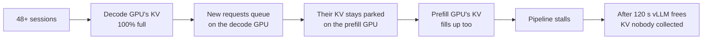

The logs show every step of it:
- the prefill server released expired KV 128 times;
- it logged "potentially invalid KV blocks … may have expired" 124 times. Those decodes read
  blocks the prefill server had already freed, which may have been reused by then, so their
  outputs may have been corrupted without any error;
- requests stuck mid-handoff hung until the client's 15-minute timeout: exactly one per session,
  48 or 64 per run;
- the router's health checks timed out and marked the decode server unhealthy five times, for
  88–113 s each. In those windows every request was rejected instantly, which explains most of
  the errors.

One 48-session run happened to survive (1,000/1,000, but at half the speed); the other two
collapsed.

**4. Admission control fixes the collapse, not the bandwidth.** With the router admitting at most
32 requests to the decode GPU, decode KV peaked at 76–82%:
- all 4,000 requests succeeded;
- no KV expired;
- the wait moved to the router queue: a median of 2.4 s at 48 sessions and 11 s at 64.

The cap of 32 comes from the data: it is the highest tested load that never filled the decode
GPU's memory.

**5. With the same memory, 1P+1D has half the prefix cache.**
- In the colocated setup, both GPUs' KV pools serve as prefix caches, 262K tokens in total.
- In 1P+1D, the decode GPU's pool is busy holding running requests, so the prompt cache is
  effectively the prefill GPU's 131K tokens.
- The prefill-side hit rate held at about 75% up to 48 sessions, then fell to 46% at 64. The likely
  reason: 64 conversations' histories don't fit in one cache, and conversations waiting in the
  router queue get evicted before their next turn.

**6. When would disaggregation win?** This experiment sits at the unfavourable corner, with a
small model, cheap prefill and a slow KV link. Disaggregation pays off when:
- the KV link is fast (NVLink or RDMA);
- prefill is heavy (a larger model or longer prompts, so it interferes more with decode);
- a TPOT target matters more than raw throughput.

The measurements show both sides of that trade-off. The decode-side benefit is real (2.4× better
TPOT at 64 sessions), and so is the cost when the handoff is slow.

Full report: [results/compare_pd_gpu/REPORT.md](../results/compare_pd_gpu/REPORT.md).

#### In the simulator

This study uses the same four simulated GPUs, organized three ways: 4 colocated workers, 2 prefill
+ 2 decode (2P+2D), and 3 prefill + 1 decode (3P+1D). It used 400 prompts and one repeat, with the
`cache_aware` router at 64 sessions:

| Configuration | TTFT p50 | TPOT p95 | E2E p95 | Throughput | Hit rate |
|---|---:|---:|---:|---:|---:|
| 4 colocated | **0.026 s** | 10.9 ms | **2.16 s** | **79.7 req/s** | 72.6% |
| 2P + 2D | 0.630 s | **3.6 ms** | 2.63 s | 51.0 req/s | 68.3% |
| 3P + 1D | 0.627 s | 4.8 ms | 3.92 s | 38.2 req/s | 66.3% |

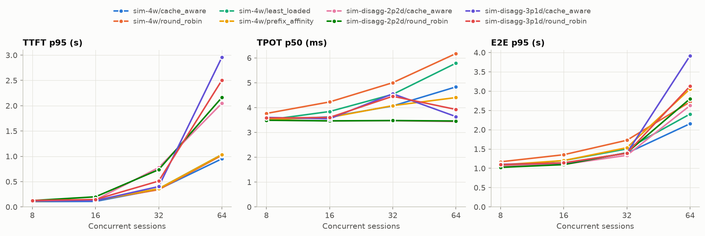

- **Disaggregation does what it promises for decode.** TPOT p95 falls from 10.9 ms to 3.6 ms, and
  median TPOT stays flat as load grows, because no prefill shares the decode GPUs.
- **The cost lands on TTFT and throughput for this workload.** These prompts are about 3,400 tokens
  with about 140-token answers, so the work is prefill-heavy. Taking half the GPUs away from
  prefill hurts more than removing interference helps.
- **The P:D ratio has to match the workload.** Shifting to 3P+1D makes the single decode worker
  the bottleneck: its KV cache peaked at 85% with 10 requests queued. Throughput then drops
  further.
- **Cache-aware routing still matters in disaggregated mode.** On the prefill pool it raised the
  hit rate from 61.1% (round-robin, 2P+2D) to 72.5% (cumulative across concurrency levels).

The simulator and the real GPUs agree on the direction of the trade-off: better TPOT, but worse
TTFT and throughput for this prefill-heavy workload. The real run adds a cause the simulator
didn't model. The simulator assumed a 25 GB/s KV link, while the real staged path delivered about
0.2 GB/s.

### 4.7 Limitations and threats to validity

- **Synthetic text.** Prompts are random vocabulary words. Qwen tokenizes them at about 5.4
  characters per token, versus about 4 for English prose. The prefix *structure* is realistic, but
  token counts per character are not.
- **Two replicas share one GPU.** They compete for the same compute and memory bandwidth. A real
  deployment would give each replica its own GPU.
- **The KV cache is artificially capped**, to create the cache pressure larger deployments see
  naturally. The size of the benefit depends on how much pressure there is.
- **Router constants are not calibrated to this GPU.**
  - `prefill_tps` is a rough guess.
  - `chars_per_token` is set to 4.0, while the measured value is 5.4. That overestimates prompt
    tokens by about 34% (uniformly, so relative costs are preserved), and sizes the index at about
    98k real tokens instead of 131k.
  - Online calibration from engine metrics would remove these guesses.
- **The matched-latency gains are lower bounds**, because the non-baseline policies never reached
  the target latency.
- **Simulator results are relative.** They come from one repeat and a 400-prompt trace.
- **The router is a single Python process.** Its overhead is the same for every policy, so the
  comparison is fair, but it is not a production data plane.
- **The real disaggregation run used a slow KV path.** Host-staged transfers ran at about 0.2 GB/s,
  because direct GPU-to-GPU reads were unsafe on these PCIe hosts. The 1P+1D vs colocated gap is
  specific to that link; NVLink or RDMA would shrink it.
- **A small model makes prefill cheap.** At 0.1 s per prompt, there is little prefill interference
  for disaggregation to remove.
- **The same KV budget per GPU** (8,192 blocks) gives 1P+1D half the prefix cache of the colocated
  setup ([4.6](#46-disaggregated-prefilldecode), point 5). That is a fair memory comparison, but
  not the only possible one.
- **The capped 1P+1D runs have 2 repeats** and cover only 48 and 64 sessions. The cap of 32 was
  chosen from this hardware's measurements; a budget counted in KV tokens would adapt to other
  setups.
- **The prefill server's cache flush failed between 1P+1D runs.** Blocks were still pinned for KV
  transfers, so vLLM refused to reset its prefix cache. The effect looks negligible: the hit rate
  (77.5%) matches the single-GPU runs (77.6–78.4%).

### 4.8 Next steps

1. **4+ replicas on separate GPUs**, to confirm on real hardware the affinity vs cost-model
   crossover that the simulator shows.
2. **Online calibration** of `prefill_tps` and `chars_per_token` from engine metrics and usage
   reports.
3. **A KV-cache-size sweep**, to plot routing benefit against cache pressure.
4. **Open-loop (Poisson) arrivals**, alongside the closed loop, to remove the start-up burst and
   test bursty traffic.
5. **Disaggregation on a fast interconnect** (NVLink or RDMA) and with a larger model, where the
   KV handoff is cheap and prefill is heavy; plus direct timing of each NIXL transfer, and an
   SGLang comparison.
6. **A KV-token admission budget** for decode workers, instead of a fixed request count, so the cap
   adapts to prompt length and cache size.
7. **A real corpus** (for example, Wikipedia passages with a real retriever) instead of synthetic
   text.

### 4.9 Reproducing the results

```bash
make install && source .venv/bin/activate && make test

# laptop, no GPU: simulator cluster + quick sweep
kvbench cluster --config configs/router/sim_local.yaml          # terminal 1
kvbench bench --experiment configs/experiments/sim_quick.yaml   # terminal 2

# GPU host (see docs/GPU_SETUP.md): 2 vLLM replicas + router, then the full sweep
VLLM_BIN=~/vllm-env/bin/vllm N=2 GPUS=0,0 bash scripts/vllm_baremetal.sh
kvbench bench --experiment configs/experiments/vllm.yaml
```

The full report for the run above is in
[results/vllm/20261108-233332/analysis/REPORT.md](../results/vllm/20261108-233332/analysis/REPORT.md).

The two-GPU disaggregation study ([4.6](#46-disaggregated-prefilldecode)) is reproduced
step by step in [RUN_DISAGG_2GPU.md](RUN_DISAGG_2GPU.md).

---

## Glossary

| Term | Meaning |
|---|---|
| **Token** | A piece of a word; the unit language models read and write |
| **Prompt** | Everything sent to the model: instructions, documents, conversation, question |
| **Prefill** | Processing the whole prompt in one parallel pass; compute-bound; sets TTFT |
| **Decode** | Generating output one token at a time; memory-bandwidth-bound; sets TPOT |
| **KV cache** | Per-token key/value vectors kept in GPU memory so later tokens can attend to earlier ones |
| **Prefix caching** | Reusing KV entries for a prompt's beginning that an earlier request already computed |
| **Block** | Fixed-size unit of KV-cache memory (16 tokens in vLLM) |
| **LRU eviction** | When memory fills, drop the least recently used entries first |
| **Replica / worker** | One running copy of the model with its own KV cache |
| **Router** | The proxy that decides which worker receives each request |
| **RAG** | Retrieval-augmented generation: retrieved documents are pasted into the prompt |
| **Tenant** | An application with its own system prompt, sharing the same model servers |
| **Continuous batching** | Engines add and remove requests from the running batch at every step |
| **Chunked prefill** | Splitting a long prompt's prefill across several steps so it can share them with decodes |
| **Prefill–decode interference** | Decode steps slowing down because they share the GPU with prefill work |
| **Disaggregated serving** | Separate GPU pools for prefill and decode, with the KV cache transferred between them |
| **NIXL / NixlConnector** | NVIDIA's transfer library and vLLM's connector for moving KV blocks between engines |
| **Colocated serving** | Every GPU runs a complete model copy that does both prefill and decode |
| **1P+1D** | A disaggregated setup with one prefill GPU and one decode GPU |
| **KV handoff** | Copying a prompt's KV cache from the prefill GPU to the decode GPU |
| **Admission control** | Holding requests in a queue until the system has room for them, instead of overloading it |
| **TTFT / TPOT / ITL / E2E** | Time to first token / time per output token / inter-token latency / end-to-end latency |
| **p50 / p95** | Median / the value 95% of requests are at or below |
| **Throughput** | Completed requests per second (steady state) |
| **Closed loop** | Each simulated user sends its next request only after the previous one finishes |
| **Concurrency** | Number of simultaneous closed-loop sessions |
| **Saturation** | The load beyond which throughput stops growing and only latency rises |
| **Matched-latency throughput** | Throughput a policy achieves while keeping p95 latency under the same target as the baseline |
| **95% CI** | Confidence interval: the range likely to contain the true mean, given run-to-run variation |
| **Rendezvous hashing** | Consistent assignment of keys to workers: each worker scores the key, and the highest score wins |
| **Zipf distribution** | A popularity pattern where a few items are very common and most are rare |
| **Load imbalance** | Max ÷ mean requests per worker (1.0 = perfectly even) |
