# kvbench, explained

**From "what does this do?" to the engineering details.**

This document explains the project in four levels. Each level assumes you read the one before it,
and you can stop wherever the detail stops being useful to you.

| Level | Written for | What it covers |
|---|---|---|
| [1. The short version](#level-1-the-short-version) | Anyone | The problem, the idea, and what the experiments found. No jargon |
| [2. The concepts](#level-2-the-concepts) | Anyone curious about how AI chat services run | Prefill and decode, the KV cache, prefix caching, why routing matters |
| [3. How it is built](#level-3-how-it-is-built) | Software engineers | Architecture, the life of a request, the workload, the router, the simulator, the benchmark harness |
| [4. Measurement and results](#level-4-measurement-and-results) | ML-systems engineers | Methodology, metric definitions, real-GPU results, simulator studies, limitations |

There is a [glossary](#glossary) at the end.

> **Viewing the diagrams.** The flowcharts are written in Mermaid, which GitHub renders
> automatically. In VS Code, install the *Markdown Preview Mermaid Support* extension
> (`code --install-extension bierner.markdown-mermaid`) to see them in the preview.

---

## Level 1: The short version

### The problem

When you ask an AI assistant a question about a company's documents, the server first has to
**read everything it was given**: its instructions, the documents a search system pulled up, and
the conversation so far. Only after that can it start writing the answer. With long documents,
this reading step is the expensive part.

Much of that reading is repetitive:

- Many people ask about the same popular documents.
- Every follow-up question in a conversation re-sends everything from the earlier turns.

Modern AI servers can **remember text they have already read** and skip re-reading it. But the
memory lives on the machine that did the reading. A real service runs many copies of the model on
many GPUs, so whether that memory gets used depends entirely on **which copy each request is sent
to**.

### An analogy

Picture a help desk with several agents. Each agent keeps notes on the documents they have already
read.

- If a question about document X goes to the agent who already read X, they answer quickly.
- If it goes to whoever is next in line, that agent reads X from scratch.
- But you can't send every question to the agent with the most notes, or they get swamped while
  the others sit idle.

So the dispatcher has to balance two things: **sending work to whoever already has the notes**,
and **keeping everyone evenly busy**. That trade-off is what this project studies.

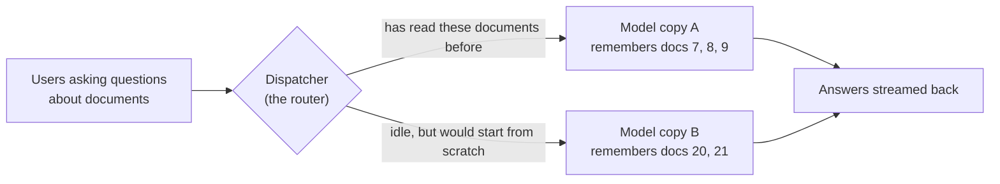

### What the project builds

1. **A router** (the dispatcher) that sits in front of several copies of a language model. It sends
   each request to the copy most likely to have already read the beginning of that request,
   without overloading anyone.
2. **A test bench** that replays 1,000 realistic document-question conversations with 8 to 64
   simultaneous users. It measures how quickly answers start, how smoothly they stream, and how
   many requests per second the system handles.
3. **A simulator** of an AI server, so the whole system can be developed and tested on a laptop
   without a GPU.

### What it found

On a real NVIDIA RTX A6000 GPU running two copies of a small open model (Qwen2.5-1.5B-Instruct,
served by vLLM), the cache-aware router was compared with handing requests out in simple
rotation (round-robin):

| | Cache-aware router vs simple rotation |
|---|---|
| Reading work the GPUs had to do | **36% less** |
| Avoidable re-reading eliminated | **77%** |
| Requests served per second at the same worst-case response time | **21% more** (±4%) |
| Time until the first word appears, typical request at peak load | **0.18 s instead of 0.28 s** |

These numbers come from 72 benchmark runs (72,000 requests, zero failures), each configuration
repeated three times.

There was also a surprise. With only two model copies, the simplest rule ("always send the same
conversation to the same copy") did even better. The smarter balancing pays off when there are
more copies, which the simulator shows with four. [Level 4](#45-what-the-results-mean) explains
why.

---

## Level 2: The concepts

### 2.1 Tokens

Language models don't read characters or whole words; they read **tokens**, which are pieces of
words. "Benchmarking" might be split into "Bench" + "mark" + "ing". In this project a typical
prompt is about 18,000 characters, or about **3,400 tokens**.

### 2.2 How a model answers: prefill, then decode

Generating an answer happens in two phases with very different performance characteristics.

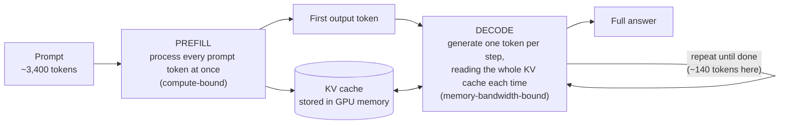

- **Prefill** reads the whole prompt in one big parallel computation. It is limited by the GPU's
  arithmetic throughput. Its duration largely sets **time to first token (TTFT)**, the wait
  before anything appears on screen.
- **Decode** produces the answer one token at a time. Each step is small, but it must read the
  model's weights and everything stored so far from GPU memory, so it is limited by memory
  bandwidth. Its speed sets **time per output token (TPOT)**, how smoothly the text streams.

Servers like vLLM and SGLang run many requests together in one batch (**continuous batching**).
A long prefill can share a GPU step with dozens of decodes, which slows those decodes down. This
**prefill–decode interference** comes up again later.

### 2.3 The KV cache

While processing each token, the model computes two vectors per layer, called the **key** and the
**value**. Every later token has to look back at all of them (this is *attention*), so they are
kept in GPU memory. That store is the **KV cache**.

It is large. For Qwen2.5-1.5B, each token needs

> 28 layers × 2 (key and value) × 2 KV heads × 128 dimensions × 2 bytes = **28 KiB**

so one 3,400-token prompt occupies about **93 MiB** of GPU memory.

### 2.4 Prefix caching: reusing what was already read

The key fact: **the KV entries for a token depend only on the tokens before it.** If two prompts
start with exactly the same text, their KV caches for that shared beginning (the **prefix**) are
identical. The second request can reuse the first one's entries and skip that part of prefill.

- **vLLM** splits the KV cache into blocks of 16 tokens. Each block is identified by a hash of its
  tokens *and* the hash of the block before it. A block can therefore be reused only if
  everything before it matches too.
- **SGLang** stores prefixes in a radix tree (RadixAttention).
- Both evict the **least recently used** entries when memory fills up.


Reuse always stops at the **first difference**. Request 4 above contains exactly the same
documents as request 1, but its system prompt differs near the very start, so none of it can be
reused. That's why prompts are laid out with the most widely shared content first.

### 2.5 Why long-context RAG has so much reuse

**RAG** (retrieval-augmented generation) means a search system finds relevant documents and pastes
them into the prompt so the model can answer from them. A RAG chat prompt looks like this:

```
<system prompt: instructions for this application>     shared by every user of the app
### Retrieved context
[doc 7] ... [doc 8] ... [doc 9] ...                     shared by everyone asking about this topic
### Conversation
User: first question   Assistant: first answer          shared by later turns of this conversation
User: new question                                      unique
Assistant:
```

In the 1,000-prompt test workload, **81.3% of all prompt text repeats something that appeared
earlier**. That is the most any cache could possibly skip.

### 2.6 Why routing decides whether reuse happens

Each model copy (a **replica**, or **worker**) has its own KV cache. A cached prefix only helps a
request that is sent to the replica holding it.

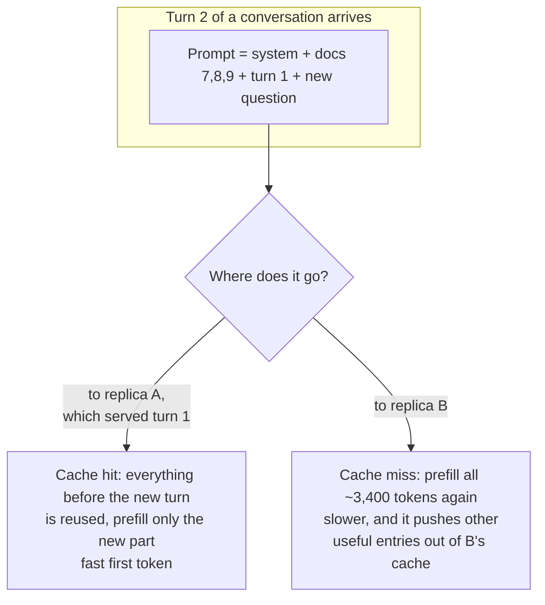

Round-robin alternates replicas, so a follow-up turn has only a 50% chance (with two replicas) of
landing where its earlier turns are cached. Pure "stickiness" fixes that, but popular topics then
pile onto one replica while the others idle. **The router's job is to trade cache locality
against load balance.**

### 2.7 How "fast" is measured

| Metric | Meaning | What a user feels |
|---|---|---|
| **TTFT** (time to first token) | Request sent → first token received | The pause before the answer starts |
| **TPOT** (time per output token) | Average gap between output tokens | How smoothly text streams |
| **E2E** (end-to-end latency) | Request sent → last token received | Total wait for the full answer |
| **Throughput** | Completed requests per second | How many users the hardware can serve |
| **p50 / p95** | The median, and the value 95% of requests beat | Typical experience / bad-day experience |

Tail latency (**p95**) matters because services promise response times to *most* users, not just
the median one.

**Throughput at matched latency** is the fair way to compare systems. You can always squeeze more
throughput out of a server by letting requests wait longer. So the question is: **with the same
latency budget, how many more requests per second does policy X handle than policy Y?** That is
the "+21%" in the results.

### 2.8 Disaggregated serving, briefly

Because prefill and decode interfere when they share a GPU, a newer design gives them **separate
GPU pools**:

- *prefill workers* process prompts and then hand the KV cache over the network;
- *decode workers* generate the tokens.

This removes the interference. The costs are the KV transfer and the need to pick the right
prefill-to-decode ratio. The project supports this mode (using vLLM's NixlConnector protocol) and
studies it in the simulator.

---

## Level 3: How it is built

### 3.1 Architecture

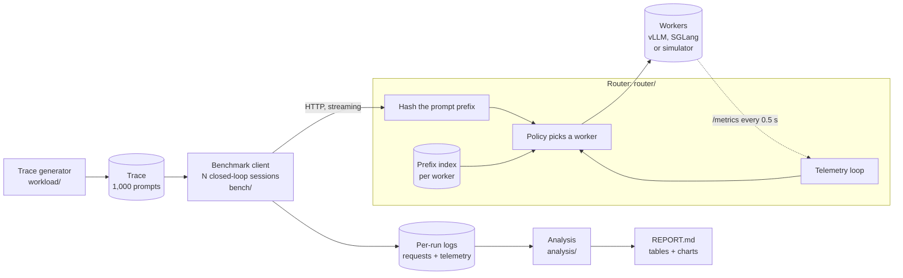

| Component | Role | Code |
|---|---|---|
| Workload generator | Builds a deterministic multi-turn RAG trace with realistic prefix sharing | `src/kvbench/workload/` |
| Router | OpenAI-compatible proxy. Hashes prompts, tracks what each worker has cached, applies a routing policy, streams responses back | `src/kvbench/router/` |
| Simulator | A GPU-free engine with paged KV blocks, prefix caching and a cost model. Speaks vLLM's API and metric names | `src/kvbench/sim/` |
| Benchmark harness | Runs policy × concurrency × repeat sweeps with cache flushes, warm-up and telemetry | `src/kvbench/bench/` |
| Analysis | Statistics, prefill accounting, matched-latency throughput, charts, report | `src/kvbench/analysis/` |
| Deployment | Docker Compose files and bare-metal scripts for vLLM, SGLang, the simulator, and disaggregated vLLM | `docker/`, `scripts/` |

Every component talks plain HTTP. The same router and benchmark therefore run unchanged against
the simulator on a laptop and against vLLM or SGLang on a GPU.

### 3.2 The life of one request

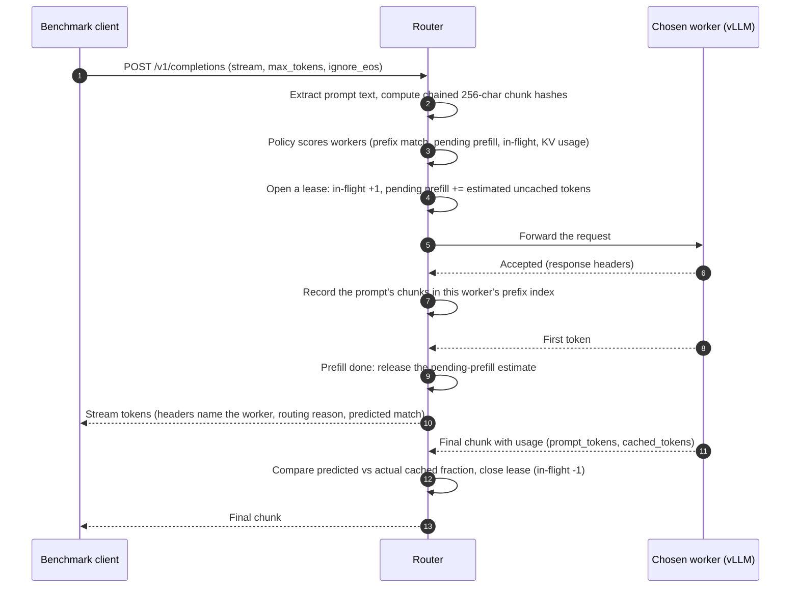

Two details matter here:

- **The index is updated when the worker accepts the request, not when it finishes.** If ten
  requests with the same new prefix arrive within a second, the first one is still prefilling
  when the others are routed. Updating early sends them to the same worker, where they can share
  the work instead of computing it ten times on different workers.
- **The router's load numbers are exact**, because every request passes through it. Engine
  metrics (queue depth, KV usage) arrive every 0.5 s and are always slightly stale. The router's
  own counters (in-flight requests, requests still in prefill, estimated pending prefill tokens)
  are current.

### 3.3 The workload: a synthetic long-context RAG service

`workload/rag.py` generates the trace from a seed, so every run replays the same 1,000 prompts:

| Ingredient | Setting | Why |
|---|---|---|
| Tenants (applications) | 3, each with a 150–400-word system prompt | Cross-user sharing of the first part of the prompt |
| Corpus | 60 topics × 6 documents of 300–900 words | Long retrieved context |
| Topic popularity | Zipf, s = 1.1 | A few hot topics create heavy reuse, plus a long tail |
| Retrieval | 3–5 documents. 70% of conversations get the topic's canonical top-k in canonical order; 30% get a shuffled subset plus an off-topic document | Partial and full prefix overlap, like real retrievers |
| Conversations | Geometric number of turns, mean 3, max 8. Each turn appends the previous Q&A | Within-session reuse |
| Output length | Log-normal, median 128 tokens (16–512), replayed exactly using `ignore_eos` | Identical decode work for every policy |

Resulting trace: **1,000 prompts in 369 conversations, mean 18,047 characters (about 3,360 tokens),
p95 24,909 characters**, with a maximum achievable prefix reuse of **81.3%**.

The document text is random words from a fixed vocabulary. The *structure* of reuse is realistic;
the *content* is not ([limitations](#47-limitations-and-threats-to-validity)).

### 3.4 The router

#### Prefix fingerprints: chained chunk hashes

The router never sees a worker's real KV cache. It identifies prefixes by hashing fixed 256-byte
chunks of the prompt, with each hash folding in the previous one:

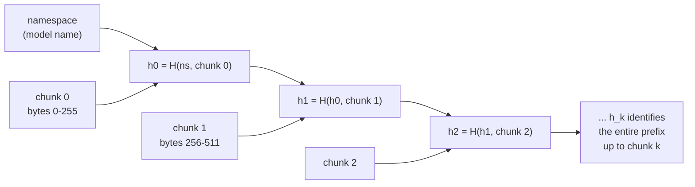

- Because of the chaining, **two prompts share their first *k* hashes exactly when they share their
  first *k* × 256 bytes.** This mirrors vLLM's block hashing but works on raw text, so the router
  doesn't need the model's tokenizer. SGLang's own router makes the same trade-off with a
  character-level radix tree.
- The hash is BLAKE2b with an 8-byte digest. The final partial chunk isn't hashed, because like a
  partial KV block it can't be shared.

#### The per-worker prefix index

`router/index.py` keeps, for each worker, the set of chunk hashes the router has *sent* there.
It assumes they are still cached. To keep that assumption honest:

- **Capacity bound with LRU eviction.** The index holds at most as many chunks as the worker's KV
  pool could hold (131,072 tokens × 4 chars/token ÷ 256 = 2,048 chunks), and evicts the least
  recently used, like the engine does.
- **Tail-first insertion.** A prompt's chunks are inserted last-to-first, so the shared head of the
  prefix is the most recently touched and is evicted last. Engines behave the same way.
- **TTL.** Entries untouched for 600 s are treated as gone.
- **Invalidation.** The index is cleared when the worker's cache is flushed, when it restarts
  (detected by its Prometheus counters going backwards), or when it is marked unhealthy.
- **Feedback.** Every response reports how many tokens the engine actually found cached. The
  router logs predicted vs actual cache fractions per worker, and can optionally shrink the index
  capacity when it keeps over-predicting.

`match(hashes)` returns how many *leading* chunks of the new prompt are in the index. That count is
the router's estimate of the cache hit.

#### The routing policies

| Policy | Rule | Strength | Weakness |
|---|---|---|---|
| `round_robin` | Next worker in rotation | Perfectly even request counts | Ignores the cache and actual work |
| `least_loaded` | Fewest in-flight requests (ties broken by pending prefill) | Reacts to load | Ignores the cache |
| `prefix_affinity` | Rendezvous hashing on the hash of the first 16 chunks (4 KB, roughly tenant + first document) | Same prefix always lands on the same worker, so the hit rate is near the maximum | Ignores load, so hot prefixes create hotspots |
| `weighted` | 0.5 × hit fraction − 0.3 × queue pressure − 0.2 × KV usage | Easy to explain | The terms have no common unit, so the weights are arbitrary |
| `cache_aware` | Minimizes an estimate of time-to-first-token (below) | Trades hit rate against load in one unit (seconds) | Needs rough calibration constants |

#### `cache_aware` in detail

For each worker *w*, with *P* the estimated prompt length in tokens and *m_w* the fraction of
its prefix already in *w*'s index:

```
cost(w) =  (pending_prefill_tokens(w) + P × (1 − m_w)) / prefill_tps     ← queued + new prefill work, in seconds
         +  decode_cost_s × decode_inflight(w)                              ← slowdown from sharing a decode batch
         +  mem_penalty_s × max(0, kv_usage(w) − 0.9) / 0.1                 ← avoid workers about to evict
```

The parameters are `prefill_tps` = 20,000 tokens/s, `decode_cost_s` = 5 ms,
`mem_penalty_s` = 1 s, and a high-watermark of 90% KV usage.

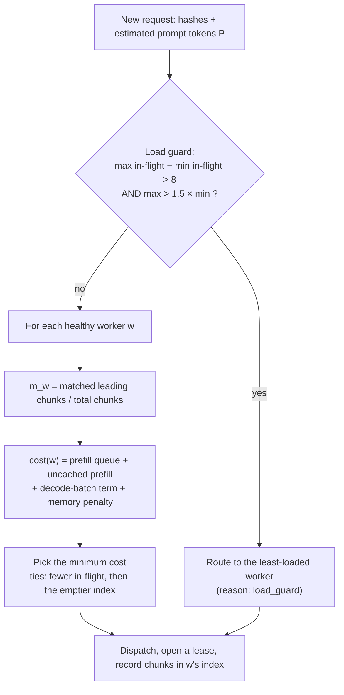

**Worked example.** A prompt estimated at *P* = 4,500 tokens arrives. Two workers:

| | matched | pending prefill | decoding | cost |
|---|---:|---:|---:|---|
| Worker A | 80% | 2,000 tokens | 30 | (2,000 + 900) / 20,000 + 30 × 0.005 = **0.295 s** |
| Worker B | 0% | 0 tokens | 24 | (0 + 4,500) / 20,000 + 24 × 0.005 = **0.345 s** |

A wins even though it is busier, because the cache hit saves more time than the extra queue costs.
If A had 4,000 tokens of pending prefill instead, its cost would be 0.395 s and B would win. The
cost function makes that trade explicitly, in seconds.

The tie-break matters at the start of a run. When all workers are idle with empty indexes, every
cost is equal. Breaking ties toward the emptier index spreads *new* prefixes across workers
instead of piling them onto worker 0.

#### Disaggregated prefill/decode mode

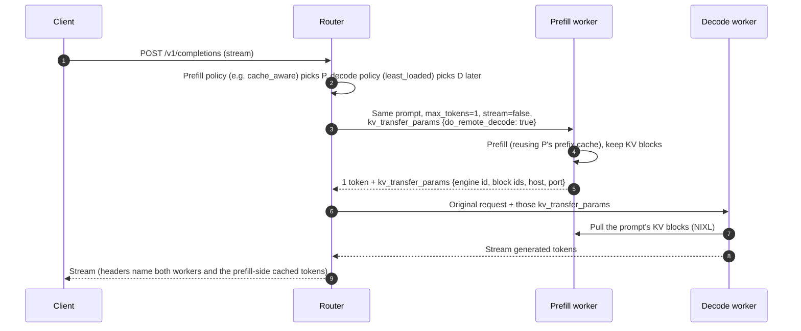

Prefix caching happens on the **prefill** pool, so the cache-aware policy routes the prefill step.
The decode step only needs free capacity, so it goes to the least-loaded decode worker.

### 3.5 The simulator

A GPU costs money by the hour, so the router and the benchmark were developed against
`kvbench sim-worker`. It is a small continuous-batching engine that behaves like vLLM from the
outside.

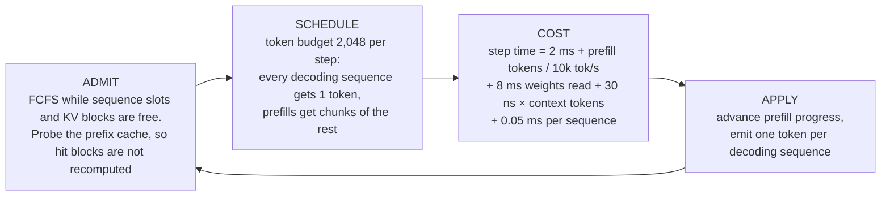

- **Paged KV blocks** of 16 tokens, a pool of 8,192 blocks, and hash-chained prefix caching with LRU
  eviction of unused cached blocks.
- **Prefill–decode interference falls out of the model.** Prefill chunks and decodes share a step,
  so a big prefill makes the step longer for every decoding sequence in it.
- **Disaggregation.** It implements the same `kv_transfer_params` protocol as vLLM, with a modeled
  KV transfer link (25 GB/s, 2 ms latency, serialized per engine).
- **Same interface as vLLM.** It exposes vLLM's endpoints and Prometheus metric names, plus
  `sim:*` metrics such as exact prefill tokens computed.
- **Relative costs only.** It is calibrated to be roughly right about *relative* costs (prefill vs
  decode, hit vs miss, transfer vs recompute), not to predict absolute numbers on real hardware.
- **Speed factor.** A `speed` setting compresses simulated time to make runs faster.

### 3.6 The benchmark harness

**Closed-loop sessions.** At concurrency *N*, there are *N* simulated users. Each takes the next
whole conversation from a shared queue and plays its turns in order, sending turn *t+1* only after
turn *t* has finished, like a real user. A session's next conversation starts as soon as its
previous one ends.

**One run** (one policy at one concurrency level for one repeat):

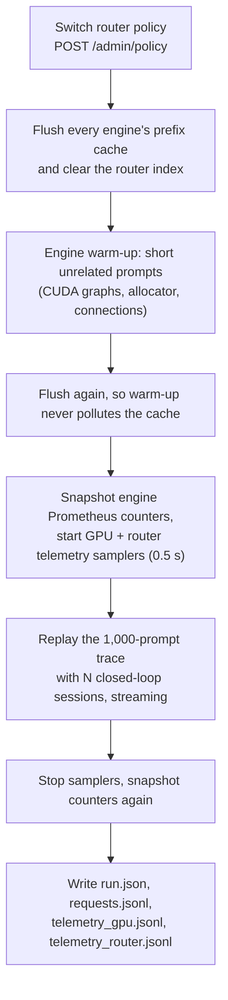

**The sweep** is 4 policies × 6 concurrency levels (8, 16, 24, 32, 48, 64) × 3 repeats = **72
runs**. Inside each (repeat, concurrency) block the policy order is shuffled, so slow drift in the
environment (GPU temperature, noisy neighbors on a shared cloud host) isn't mistaken for a policy
effect.

**Per request**, the client records:

- TTFT, the time of the first non-empty token;
- every inter-token gap;
- E2E latency;
- token counts and `cached_tokens` from the engine's usage report;
- the worker and routing reason from the router's `x-kvbench-*` response headers.

### 3.7 The analysis pipeline

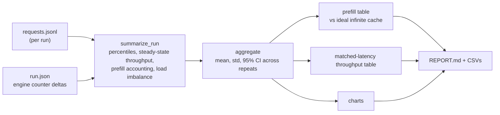

`kvbench analyze` can combine several result directories into one report, for example colocated
vs disaggregated, or vLLM vs SGLang.

### 3.8 Testing

There are 43 tests (`pytest`, about 10 s, no GPU needed):

- **Unit tests** for prefix hashing, the index, every policy, the block manager, the simulator
  engine, the workload generator, and the analysis math (percentiles, interpolation, flat-region
  detection, prefill accounting).
- **End-to-end tests** that start real router and simulator servers on local ports and push
  requests through them.

---

## Level 4: Measurement and results

### 4.1 Experimental setup (real GPU)

| | |
|---|---|
| Hardware | 1× NVIDIA RTX A6000 (48 GB), RunPod |
| Engine | vLLM 0.11.0, prefix caching on, `--enable-prompt-tokens-details` |
| Model | Qwen2.5-1.5B-Instruct, **2 replicas on the same GPU** (`--gpu-memory-utilization 0.40` each) |
| KV cache per replica | Capped at **8,192 blocks = 131,072 tokens (≈ 3.5 GiB)** using `--num-gpu-blocks-override` |
| Other engine limits | `--max-model-len 16384`, `--max-num-seqs 64` |
| Router | `cache_aware` parameters as in [3.4](#cache_aware-in-detail), same host |
| Workload | The 1,000-prompt trace above, identical for every run |
| Sweep | 4 policies × concurrency {8, 16, 24, 32, 48, 64} × 3 repeats = 72 runs, 72,000 requests |
| Duration and errors | 3.4 hours of benchmarking, **0 failed requests** |

**Why cap the KV cache?** Uncapped, each replica could hold most of the working set, every policy
would hit close to the 81% ceiling, and routing wouldn't matter. With the cap:

- one replay contains about 627,000 tokens of *distinct* prefix content;
- the two replicas together can hold only 262,144 tokens;
- so caches must evict, and routing decides what survives.

That is the regime a production system is in with bigger models, longer contexts, or more traffic.

**Why a 1.5B model?** It saturates the GPU within the tested range. Under round-robin, p95 E2E
latency climbs from 5.1 s at 8 sessions to 16.7 s at 64, while throughput flattens at about 7.8
requests/s. A matched-latency comparison only means something on a saturating curve.

### 4.2 Methodology controls

- **Identical work.** Every run replays the same prompts with the same output lengths
  (`ignore_eos` with fixed `max_tokens`, temperature 0).
- **Cold start.** Before every run, engine prefix caches are flushed (`POST /reset_prefix_cache`,
  enabled by `VLLM_SERVER_DEV_MODE=1`) and the router index is cleared.
- **Warm-up excluded.** Short unrelated prompts warm the engine, then the cache is flushed again.
- **Order randomized.** Policy order is shuffled within each (repeat, concurrency) block.
- **Repeats and uncertainty.** There are 3 repeats per point, and tables show the mean ± a 95%
  confidence interval (Student's *t*).
- **Steady-state throughput.** This counts completions between the 10th and 90th percentile
  completion times. That excludes the ramp-up at the start of a closed-loop run and the drain at
  the end.

### 4.3 Metric definitions and how the accounting was checked

**Prefill accounting.** Each policy's prefill work is compared with two references.

- **Computed prefill tokens** = Σ (prompt tokens − cached tokens), from each engine's own
  `usage.prompt_tokens_details.cached_tokens`.
- **Ideal prefill** = what a single *infinitely large* cache would still have to compute. This is
  the number of distinct 256-char chunks in the trace, converted to tokens using the measured
  tokens-per-character ratio.
- **Redundant prefill** = computed − ideal. This is the work a perfect router with unlimited
  memory would avoid. Reduction percentages are reported for both total and redundant prefill.
  These are *token* counts, not GPU-time savings.

**Cross-check.** The prefill numbers depend on the cached-token counts reported per request.
Those were checked against vLLM's independent Prometheus counters (`prefix_cache_queries` /
`prefix_cache_hits`). **The two agree within 0.07 percentage points in all 72 runs.**

Getting there required fixing a subtle bug. vLLM *omits* `prompt_tokens_details` entirely when a
request had zero cached tokens, instead of reporting 0. The first version of the analysis treated
"missing" as "unknown" and dropped those requests. That silently removed exactly the cold misses
and inflated hit rates. Now, if a backend reports cached tokens for any request in a run, a missing
value counts as 0. A regression test covers it.

**Matched-latency throughput:**

1. For each policy, plot steady-state throughput against p95 E2E latency across the concurrency
   levels.
2. Pick a latency target *T*. By default *T* is the **baseline's p95 at its highest concurrency**:
   the tail latency round-robin needed to carry its peak load.
3. For each policy, find the highest throughput whose p95 is ≤ *T*, interpolating linearly between
   adjacent concurrency points.
4. Report the gain over the baseline at the same *T*, as the mean curve and as the mean ± CI of
   per-repeat gains.

Two flags guard against misleading numbers:

- **`lower bound`**: the policy never got as slow as *T* at any tested concurrency, so its true
  throughput at *T* is at least the reported value.
- **`flat region`**: *T* falls where latency barely changes with load (elasticity < 0.25). There,
  tiny latency differences turn into huge throughput differences. An early simulator analysis
  placed *T* in such a region and produced a meaningless "+101%". That is why the default target
  moved to the baseline's peak-load latency, and why the flag exists.

### 4.4 Results

**Headline table** (prefill summed over all concurrency levels; mean of 3 repeats):

| Policy | Prompt tokens served from cache | Prefill tokens computed | vs round-robin | Redundant prefill vs round-robin | Throughput at p95 E2E ≤ 16.70 s | vs round-robin |
|---|---:|---:|---:|---:|---:|---:|
| `round_robin` | 64.7% | 7.12 M | — | — | 7.84 req/s | — |
| `least_loaded` | 73.9% | 5.25 M | −26.2% | −55.6% | ≥ 9.25 req/s | **+18.2% ± 3.2%** |
| `cache_aware` | 77.4% | 4.54 M | **−36.2%** | **−76.7%** | ≥ 9.49 req/s | **+21.2% ± 4.1%** |
| `prefix_affinity` | 79.5% | 4.12 M | −42.1% | −89.3% | ≥ 10.06 req/s | **+28.5% ± 6.3%** |
| *infinite cache (ideal)* | *81.3%* | *3.76 M* | | | | |

"≥" marks a lower bound: none of the three policies reached 16.70 s even at 64 sessions.


*Each point is one concurrency level, labeled with the number of sessions. Up and to the left is
better. Round-robin flattens out first; the vertical line is the matched-latency target.*


**At peak load (64 concurrent sessions):**

| Policy | TTFT p50 | TTFT p95 after start-up* | TPOT p50 | TPOT p95 | E2E p95 | Throughput |
|---|---:|---:|---:|---:|---:|---:|
| `round_robin` | 0.275 s | 0.673 s | 54.2 ms | 81.0 ± 16.7 ms | 16.70 ± 2.34 s | 7.84 req/s |
| `least_loaded` | 0.204 s | 0.539 s | 46.9 ms | 59.7 ms | 13.90 s | 9.25 req/s |
| `cache_aware` | **0.175 s** | **0.462 s** | 46.4 ms | 57.7 ms | 13.74 s | 9.49 req/s |
| `prefix_affinity` | 0.186 s | 0.489 s | **43.3 ms** | **56.1 ms** | **12.69 s** | **10.06 req/s** |

\* Requests started in the first 15 s of the run are excluded. Including them, TTFT p95 is about
1.8–1.9 s for every policy, for the reason explained in point 6 below.


### 4.5 What the results mean

**1. Cache-aware routing cuts prefill work, consistently.** `cache_aware` computes 33.9%–37.6%
fewer prefill tokens than round-robin at *every* concurrency level, and removes about three
quarters of the redundant prefill.

**2. Less prefill also makes decoding faster.** At 64 sessions, TPOT p95 drops from 81.0 ms to
57.7 ms (−29%), even though routing does nothing to decode directly. With chunked prefill, prompt
chunks share GPU steps with decoding sequences, so every prefill token avoided makes those steps
shorter. That's the prefill–decode interference from [2.2](#22-how-a-model-answers-prefill-then-decode),
showing up in real measurements.

**3. Round-robin still gets 65% cache hits.** It isn't starting from zero:

- the three system prompts and the most popular documents end up cached on *both* replicas;
- with two replicas, a follow-up turn lands on the replica holding its earlier turns half the time.

The routing gains come from what is left: the conversation history, and the less popular
documents that don't fit in both caches at once.

**4. Round-robin balances request counts, not memory.** The per-replica KV usage below shows
round-robin at one point running one replica at about 98% of its KV cache while the other sat near 25–30%.
Near-full caches force evictions (and, in vLLM, preemptions). That explains round-robin's noisy
tail, with a TPOT p95 confidence interval of ±16.7 ms. The cache-aware policies keep both replicas
in a narrow band.


**5. With two replicas, simple prefix affinity won, and the reason matters.** `prefix_affinity`
reached a 79.5% hit rate, close to the 81.3% ceiling. Its load imbalance was 1.09: one replica
handled about 54.5% of requests, the other 45.5%.

`cache_aware` deliberately gives up some locality for balance: imbalance 1.02, hit rate 77.4%. With
only two replicas, a 9% imbalance costs less than the extra cache misses, so pure affinity comes
out ahead.

Hotspots get worse as the number of workers grows and popularity gets more skewed. The simulator,
with four workers, shows the crossover:

| Simulator, 4 workers, 64 sessions | Load imbalance | p95 E2E | Matched-latency throughput vs round-robin |
|---|---:|---:|---:|
| `prefix_affinity` | **1.40** | 3.06 s | +16.9% |
| `cache_aware` | 1.12 | **2.16 s** | **≥ +37.8%** |


*In the 4-worker simulation, `prefix_affinity`'s hottest worker becomes the bottleneck at 64
sessions: its curve bends right, past the round-robin target. `cache_aware` keeps scaling.
Simulator numbers are relative, from 400 prompts and one repeat.*

The honest summary: **pure affinity is the right choice when the replica count is small and load
is fairly even, and cost-based balancing pays off as the cluster grows.** Confirming that crossover
on real GPUs (4+ replicas) is the most valuable next experiment.

**6. Tail TTFT at 64 sessions is a start-up effect.** All 64 sessions send their first request in
the same second, and all of them are cold (empty cache), so roughly 200,000 prompt tokens hit two
replicas at once. Requests started in that first second waited about 3.7 s for their first token
under every policy, which sets the p95 for the whole run. Excluding the first 15 s, TTFT p95 is
0.46 s for `cache_aware` vs 0.67 s for round-robin (−31%). An open-loop arrival pattern, or
staggered session starts, would remove this artifact.

**7. GPU memory is flat by design.** NVML reports a constant 15.7–15.9 GiB within every run, because
vLLM pre-allocates its KV pool at start-up. The useful memory signal is the engine's KV-usage
percentage (the chart above), not the process's memory footprint.

### 4.6 Disaggregated prefill/decode (simulator study)

This study uses the same four simulated GPUs, organized three ways: 4 colocated workers, 2 prefill
+ 2 decode (2P+2D), and 3 prefill + 1 decode (3P+1D). It used 400 prompts and one repeat, with the
`cache_aware` router at 64 sessions:

| Configuration | TTFT p50 | TPOT p95 | E2E p95 | Throughput | Hit rate |
|---|---:|---:|---:|---:|---:|
| 4 colocated | **0.026 s** | 10.9 ms | **2.16 s** | **79.7 req/s** | 72.6% |
| 2P + 2D | 0.630 s | **3.6 ms** | 2.63 s | 51.0 req/s | 68.3% |
| 3P + 1D | 0.627 s | 4.8 ms | 3.92 s | 38.2 req/s | 66.3% |


- **Disaggregation does what it promises for decode.** TPOT p95 falls from 10.9 ms to 3.6 ms, and
  median TPOT stays flat as load grows, because no prefill shares the decode GPUs.
- **The cost lands on TTFT and throughput for this workload.** These prompts are about 3,400 tokens
  with about 140-token answers, so the work is prefill-heavy. Taking half the GPUs away from
  prefill hurts more than removing interference helps.
- **The P:D ratio has to match the workload.** Shifting to 3P+1D makes the single decode worker
  the bottleneck: its KV cache peaked at 85% with 10 requests queued. Throughput then drops
  further.
- **Cache-aware routing still matters in disaggregated mode.** On the prefill pool it raised the
  hit rate from 61.1% (round-robin, 2P+2D) to 72.5% (cumulative across concurrency levels).

These results are from the simulator. The real vLLM disaggregated path (NixlConnector,
`docker/compose.vllm-disagg.yml`) is implemented, but it needs at least two GPUs and hasn't been
measured yet.

### 4.7 Limitations and threats to validity

- **Synthetic text.** Prompts are random vocabulary words. Qwen tokenizes them at about 5.4
  characters per token, versus about 4 for English prose. The prefix *structure* is realistic, but
  token counts per character are not.
- **Two replicas share one GPU.** They compete for the same compute and memory bandwidth. A real
  deployment would give each replica its own GPU.
- **The KV cache is artificially capped**, to create the cache pressure larger deployments see
  naturally. The size of the benefit depends on how much pressure there is.
- **Router constants are not calibrated to this GPU.**
  - `prefill_tps` is a rough guess.
  - `chars_per_token` is set to 4.0, while the measured value is 5.4. That overestimates prompt
    tokens by about 34% (uniformly, so relative costs are preserved), and sizes the index at about
    98k real tokens instead of 131k.
  - Online calibration from engine metrics would remove these guesses.
- **The matched-latency gains are lower bounds**, because the non-baseline policies never reached
  the target latency.
- **Simulator results are relative.** They come from one repeat and a 400-prompt trace.
- **The router is a single Python process.** Its overhead is the same for every policy, so the
  comparison is fair, but it is not a production data plane.

### 4.8 Next steps

1. **4+ replicas on separate GPUs**, to confirm on real hardware the affinity vs cost-model
   crossover that the simulator shows.
2. **Online calibration** of `prefill_tps` and `chars_per_token` from engine metrics and usage
   reports.
3. **A KV-cache-size sweep**, to plot routing benefit against cache pressure.
4. **Open-loop (Poisson) arrivals**, alongside the closed loop, to remove the start-up burst and
   test bursty traffic.
5. **Real disaggregation** with vLLM + NIXL on 2 GPUs, and an SGLang comparison on the same
   hardware.
6. **A real corpus** (for example, Wikipedia passages with a real retriever) instead of synthetic
   text.

### 4.9 Reproducing the results

```bash
make install && source .venv/bin/activate && make test

# laptop, no GPU: simulator cluster + quick sweep
kvbench cluster --config configs/router/sim_local.yaml          # terminal 1
kvbench bench --experiment configs/experiments/sim_quick.yaml   # terminal 2

# GPU host (see docs/GPU_SETUP.md): 2 vLLM replicas + router, then the full sweep
VLLM_BIN=~/vllm-env/bin/vllm N=2 GPUS=0,0 bash scripts/vllm_baremetal.sh
kvbench bench --experiment configs/experiments/vllm.yaml
```

The full report for the run above is in
[results/vllm/20261108-233332/analysis/REPORT.md](../results/vllm/20261108-233332/analysis/REPORT.md).

---

## Glossary

| Term | Meaning |
|---|---|
| **Token** | A piece of a word; the unit language models read and write |
| **Prompt** | Everything sent to the model: instructions, documents, conversation, question |
| **Prefill** | Processing the whole prompt in one parallel pass; compute-bound; sets TTFT |
| **Decode** | Generating output one token at a time; memory-bandwidth-bound; sets TPOT |
| **KV cache** | Per-token key/value vectors kept in GPU memory so later tokens can attend to earlier ones |
| **Prefix caching** | Reusing KV entries for a prompt's beginning that an earlier request already computed |
| **Block** | Fixed-size unit of KV-cache memory (16 tokens in vLLM) |
| **LRU eviction** | When memory fills, drop the least recently used entries first |
| **Replica / worker** | One running copy of the model with its own KV cache |
| **Router** | The proxy that decides which worker receives each request |
| **RAG** | Retrieval-augmented generation: retrieved documents are pasted into the prompt |
| **Tenant** | An application with its own system prompt, sharing the same model servers |
| **Continuous batching** | Engines add and remove requests from the running batch at every step |
| **Chunked prefill** | Splitting a long prompt's prefill across several steps so it can share them with decodes |
| **Prefill–decode interference** | Decode steps slowing down because they share the GPU with prefill work |
| **Disaggregated serving** | Separate GPU pools for prefill and decode, with the KV cache transferred between them |
| **NIXL / NixlConnector** | NVIDIA's transfer library and vLLM's connector for moving KV blocks between engines |
| **TTFT / TPOT / ITL / E2E** | Time to first token / time per output token / inter-token latency / end-to-end latency |
| **p50 / p95** | Median / the value 95% of requests are at or below |
| **Throughput** | Completed requests per second (steady state) |
| **Closed loop** | Each simulated user sends its next request only after the previous one finishes |
| **Concurrency** | Number of simultaneous closed-loop sessions |
| **Saturation** | The load beyond which throughput stops growing and only latency rises |
| **Matched-latency throughput** | Throughput a policy achieves while keeping p95 latency under the same target as the baseline |
| **95% CI** | Confidence interval: the range likely to contain the true mean, given run-to-run variation |
| **Rendezvous hashing** | Consistent assignment of keys to workers: each worker scores the key, and the highest score wins |
| **Zipf distribution** | A popularity pattern where a few items are very common and most are rare |
| **Load imbalance** | Max ÷ mean requests per worker (1.0 = perfectly even) |
