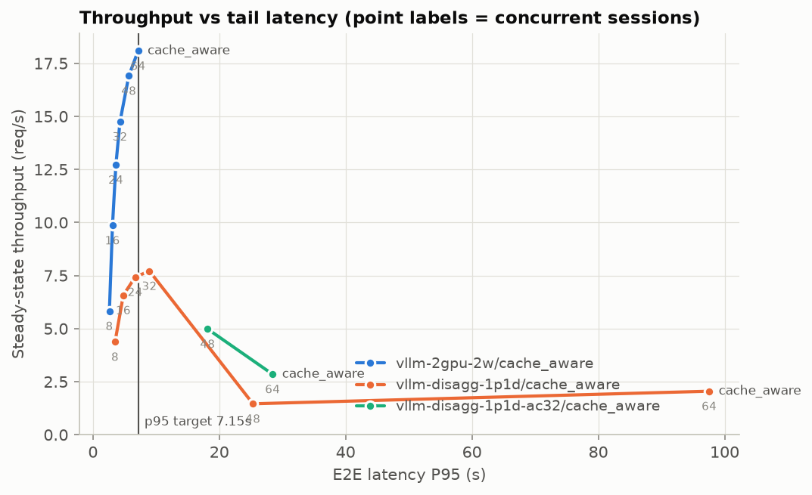
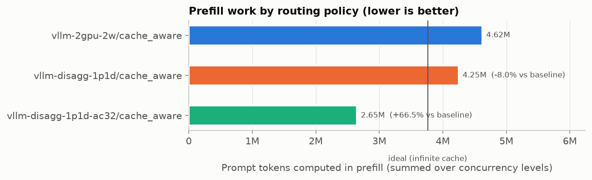
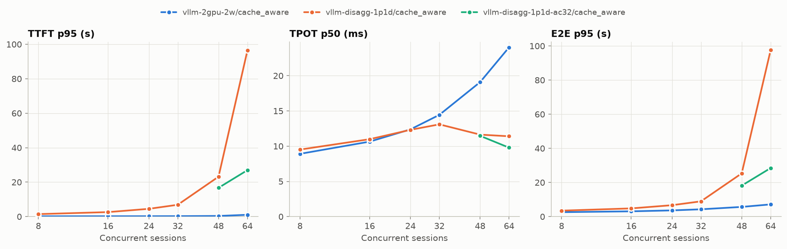
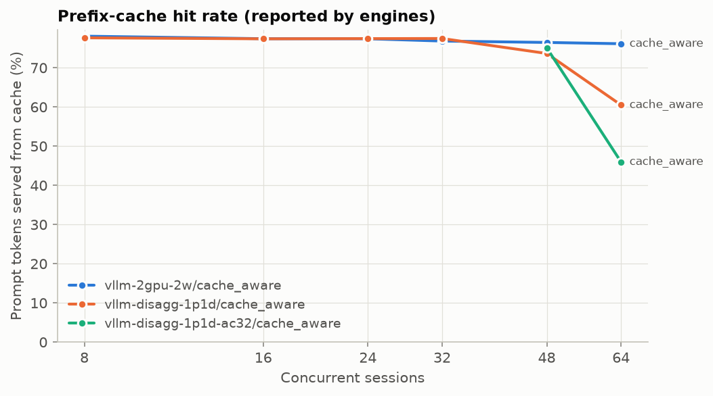
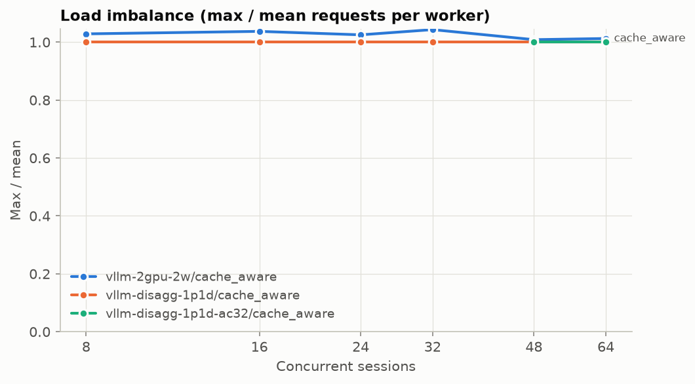
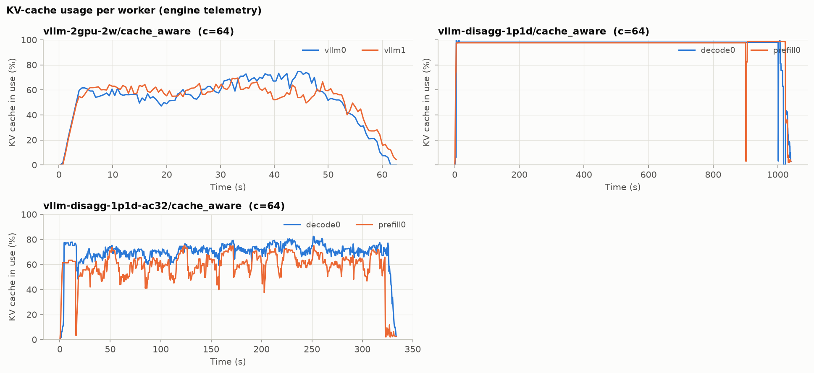
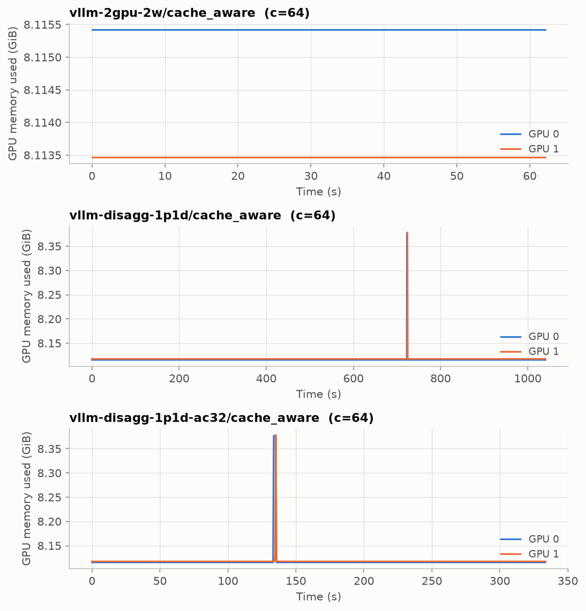

# KV-cache-aware routing benchmark report

Generated 2026-11-10 23:20 from: `results/vllm_2gpu/20261111-054708`, `results/vllm_disagg/20261111-020116`, `results/vllm_disagg_ac/20261111-052406`

- Labels compared: `vllm-2gpu-2w/cache_aware`, `vllm-disagg-1p1d-ac32/cache_aware`, `vllm-disagg-1p1d/cache_aware`
- Baseline: `vllm-2gpu-2w/cache_aware`
- Concurrency levels: [8, 16, 24, 32, 48, 64]; repeats per point: 3
- Trace: 1000 prompts in 369 conversations; mean prompt 18,047 chars (p95 24,909); max achievable prefix reuse 81.3% of prompt characters

## Headline numbers

**Prefill work** (summed over all concurrency levels, mean across repeats):

| label | prompt tokens | computed prefill tokens | hit rate | ideal (∞ cache) | redundant | total prefill Δ vs baseline | redundant prefill Δ vs baseline |
|---|---:|---:|---:|---:|---:|---:|---:|
| `vllm-2gpu-2w/cache_aware` | 20146326 | 4623153 | 77.1% | 3762600 | 860553 | 0.0% | 0.0% |
| `vllm-disagg-1p1d/cache_aware` | 17137209 | 4251695 | 75.2% | 3762381 | 489313 | 8.0% | 43.1% |
| `vllm-disagg-1p1d-ac32/cache_aware` | 6715442 | 2650594 | 60.5% | 1254200 | 1396394 | -66.5% | -314.0% |

Positive Δ = less prefill work than the baseline. These are *token* counts; they are not GPU-time or latency reductions.

**Throughput at matched e2e p95 ≤ 7.153 s** (auto: the baseline’s tail latency at its highest concurrency level):

Read the *note* column before quoting a number: `lower bound` = the policy stayed under the target at every tested concurrency (true value is higher); `flat region` = the target falls where latency barely rises with load, so small latency differences become large throughput differences. Do not quote flat-region results; extend the concurrency sweep or pass `--slo-target` nearer saturation.

| label | throughput at target (req/s) | Δ vs baseline (mean curve) | Δ per repeat (mean ± 95% CI) | note |
|---|---:|---:|---:|---|
| `vllm-2gpu-2w/cache_aware` | 18.09 | 0.0% | 0.0 ± 0.0% | ok |
| `vllm-disagg-1p1d/cache_aware` | 7.49 | -58.6% | -58.5 ± 3.6% | ok |
| `vllm-disagg-1p1d-ac32/cache_aware` | – | – | –% | target below every measured point |

## Latency and throughput by concurrency

Mean across repeats ± 95% CI half-width (when repeats > 1). TTFT/E2E in seconds, TPOT in milliseconds.

| label | conc | TTFT p50 | TTFT p95 | TPOT p50 (ms) | TPOT p95 (ms) | E2E p50 | E2E p95 | throughput (req/s) | output tok/s | hit rate | imbalance | errors |
|---|---:|---:|---:|---:|---:|---:|---:|---:|---:|---:|---:|---:|
| `vllm-2gpu-2w/cache_aware` | 8 | 0.079 ± 0.002 | 0.193 ± 0.009 | 8.9 ± 0.1 | 10.1 ± 0.2 | 1.241 ± 0.004 | 2.604 ± 0.127 | 5.82 ± 0.05 | 820 | 78.1% | 1.03 | 0.00% |
| `vllm-2gpu-2w/cache_aware` | 16 | 0.089 ± 0.001 | 0.213 ± 0.007 | 10.6 ± 0.0 | 12.2 ± 0.2 | 1.454 ± 0.018 | 3.093 ± 0.023 | 9.86 ± 0.07 | 1345 | 77.4% | 1.04 | 0.00% |
| `vllm-2gpu-2w/cache_aware` | 24 | 0.095 ± 0.002 | 0.229 ± 0.010 | 12.4 ± 0.1 | 14.6 ± 0.2 | 1.703 ± 0.022 | 3.635 ± 0.077 | 12.72 ± 0.03 | 1705 | 77.4% | 1.03 | 0.00% |
| `vllm-2gpu-2w/cache_aware` | 32 | 0.106 ± 0.001 | 0.256 ± 0.013 | 14.4 ± 0.2 | 17.3 ± 0.6 | 1.958 ± 0.028 | 4.284 ± 0.106 | 14.75 ± 0.07 | 1955 | 76.8% | 1.04 | 0.00% |
| `vllm-2gpu-2w/cache_aware` | 48 | 0.124 ± 0.003 | 0.377 ± 0.037 | 19.1 ± 0.2 | 23.1 ± 0.4 | 2.532 ± 0.012 | 5.678 ± 0.091 | 16.91 ± 0.03 | 2200 | 76.5% | 1.01 | 0.00% |
| `vllm-2gpu-2w/cache_aware` | 64 | 0.148 ± 0.015 | 1.054 ± 0.286 | 24.0 ± 0.4 | 29.2 ± 1.7 | 3.115 ± 0.065 | 7.153 ± 0.237 | 18.09 ± 0.51 | 2288 | 76.1% | 1.01 | 0.00% |
| `vllm-disagg-1p1d/cache_aware` | 8 | 0.326 ± 0.015 | 1.449 ± 0.164 | 9.5 ± 0.3 | 10.0 ± 0.6 | 1.665 ± 0.007 | 3.499 ± 0.184 | 4.37 ± 0.08 | 606 | 77.6% | 1.00 | 0.00% |
| `vllm-disagg-1p1d/cache_aware` | 16 | 0.663 ± 0.186 | 2.611 ± 0.513 | 11.0 ± 0.0 | 11.8 ± 0.2 | 2.201 ± 0.178 | 4.807 ± 0.524 | 6.57 ± 0.49 | 874 | 77.4% | 1.00 | 0.07% |
| `vllm-disagg-1p1d/cache_aware` | 24 | 1.193 ± 0.095 | 4.512 ± 0.875 | 12.3 ± 0.3 | 13.8 ± 0.2 | 2.886 ± 0.147 | 6.688 ± 0.616 | 7.43 ± 0.37 | 971 | 77.4% | 1.00 | 0.07% |
| `vllm-disagg-1p1d/cache_aware` | 32 | 1.901 ± 0.280 | 6.864 ± 0.865 | 13.1 ± 1.9 | 15.9 ± 1.1 | 3.729 ± 0.369 | 8.947 ± 0.286 | 7.71 ± 0.40 | 984 | 77.5% | 1.00 | 0.00% |
| `vllm-disagg-1p1d/cache_aware` | 48 | 13.143 ± 4.458 | 23.166 ± 9.709 | 11.6 ± 0.9 | 16.9 ± 1.5 | 14.599 ± 4.197 | 25.334 ± 10.030 | 1.46 ± 4.33 | 223 | 73.6% | 1.00 | 25.03% |
| `vllm-disagg-1p1d/cache_aware` | 64 | 47.434 ± 116.076 | 96.502 ± 139.254 | 11.4 ± 2.8 | 15.0 ± 6.2 | 48.885 ± 115.363 | 97.561 ± 139.820 | 2.05 ± 3.96 | 44 | 60.5% | 1.00 | 64.37% |
| `vllm-disagg-1p1d-ac32/cache_aware` | 48 | 4.924 ± 4.413 | 16.704 ± 4.775 | 11.5 ± 0.8 | 15.8 ± 2.4 | 7.270 ± 4.845 | 18.156 ± 3.591 | 4.98 ± 1.91 | 700 | 75.1% | 1.00 | 0.00% |
| `vllm-disagg-1p1d-ac32/cache_aware` | 64 | 20.685 ± 3.930 | 26.964 ± 2.000 | 9.8 ± 0.4 | 15.1 ± 12.6 | 22.034 ± 3.227 | 28.450 ± 1.596 | 2.85 ± 0.05 | 424 | 46.0% | 1.00 | 0.00% |

## Prefill work by concurrency

| label | conc | computed prefill tokens | hit rate | total Δ vs baseline | redundant Δ vs baseline |
|---|---:|---:|---:|---:|---:|
| `vllm-2gpu-2w/cache_aware` | 8 | 736596 | 78.1% | 0.0% | 0.0% |
| `vllm-2gpu-2w/cache_aware` | 16 | 758206 | 77.4% | 0.0% | 0.0% |
| `vllm-2gpu-2w/cache_aware` | 24 | 758628 | 77.4% | 0.0% | 0.0% |
| `vllm-2gpu-2w/cache_aware` | 32 | 778228 | 76.8% | 0.0% | 0.0% |
| `vllm-2gpu-2w/cache_aware` | 48 | 790254 | 76.5% | 0.0% | 0.0% |
| `vllm-2gpu-2w/cache_aware` | 64 | 801241 | 76.1% | 0.0% | 0.0% |
| `vllm-disagg-1p1d-ac32/cache_aware` | 48 | 836881 | 75.1% | -5.9% | -28.6% |
| `vllm-disagg-1p1d-ac32/cache_aware` | 64 | 1813713 | 46.0% | -126.4% | -581.4% |
| `vllm-disagg-1p1d/cache_aware` | 8 | 750542 | 77.6% | -1.9% | -12.7% |
| `vllm-disagg-1p1d/cache_aware` | 16 | 758727 | 77.4% | -0.1% | -0.4% |
| `vllm-disagg-1p1d/cache_aware` | 24 | 756922 | 77.4% | 0.2% | 1.3% |
| `vllm-disagg-1p1d/cache_aware` | 32 | 756377 | 77.5% | 2.8% | 14.5% |
| `vllm-disagg-1p1d/cache_aware` | 48 | 662690 | 73.6% | 16.1% | 78.1% |
| `vllm-disagg-1p1d/cache_aware` | 64 | 566436 | 60.5% | 29.3% | 134.8% |

## Metric definitions

- **TTFT**: request sent → first non-empty token received (client-side, includes routing and queueing).
- **TPOT**: (E2E − TTFT) / (completion tokens − 1).
- **E2E**: request sent → final chunk received.
- **Throughput**: completed requests per second between the 10th and 90th percentile completion times (excludes closed-loop ramp-up and drain).
- **Computed prefill tokens**: Σ (prompt_tokens − cached_tokens) using engine-reported `usage.prompt_tokens_details.cached_tokens` (prefill worker's usage in disaggregated mode).
- **Ideal prefill**: distinct prefix chunks in the trace (what one infinite cache would compute), converted to tokens with the measured tokens/char ratio. **Redundant** = computed − ideal.
- **Matched-latency throughput**: highest throughput (measured or linearly interpolated between adjacent concurrency points) whose tail latency is ≤ the target.
- **Load imbalance**: max / mean requests handled per worker (1.0 = perfectly even).
