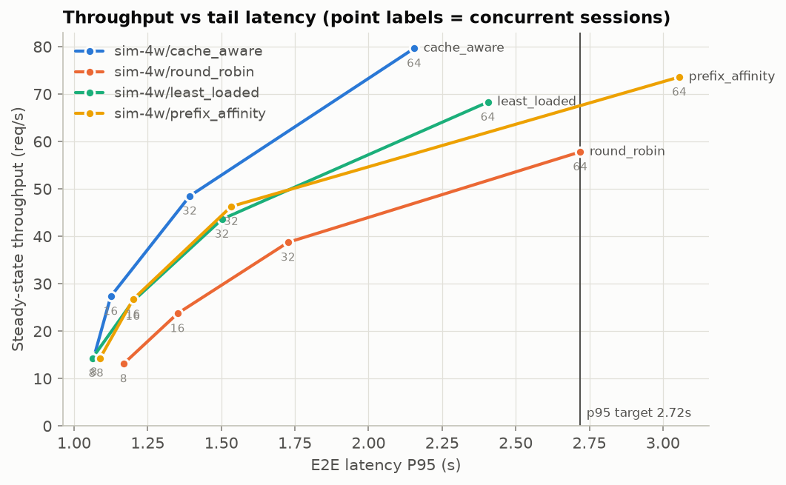
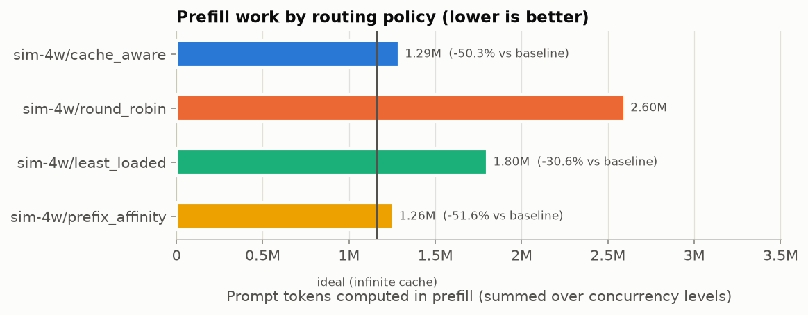
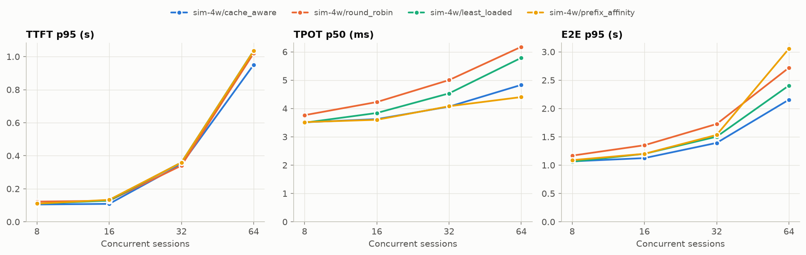
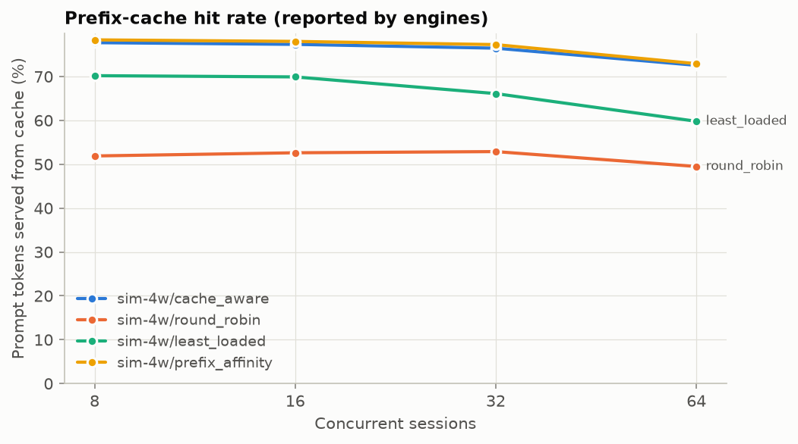
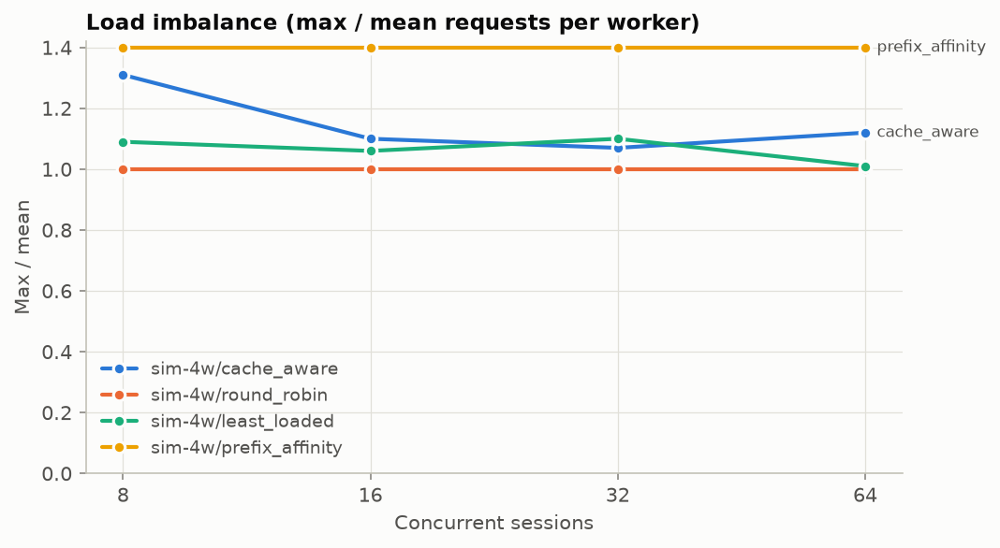
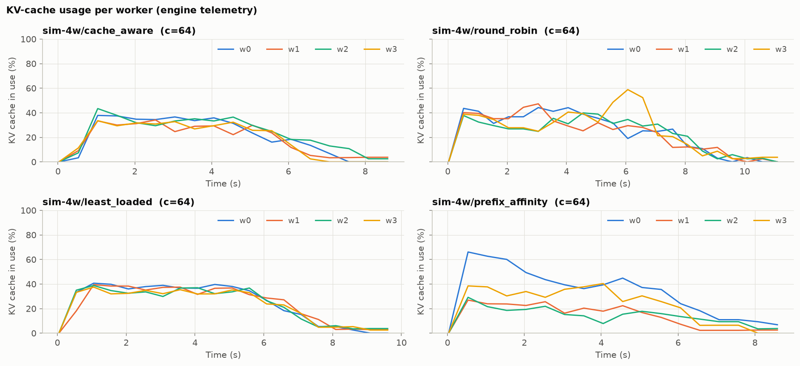

# KV-cache-aware routing benchmark report

Generated 2026-11-08 15:14 from: `results/sim_quick/20261108-145949`

- Labels compared: `sim-4w/cache_aware`, `sim-4w/least_loaded`, `sim-4w/prefix_affinity`, `sim-4w/round_robin`
- Baseline: `sim-4w/round_robin`
- Concurrency levels: [8, 16, 32, 64]; repeats per point: 1
- Trace: 400 prompts in 148 conversations; mean prompt 18,079 chars (p95 25,385); max achievable prefix reuse 78.4% of prompt characters

## Headline numbers

**Prefill work** (summed over all concurrency levels, mean across repeats):

| label | prompt tokens | computed prefill tokens | hit rate | ideal (∞ cache) | redundant | total prefill Δ vs baseline | redundant prefill Δ vs baseline |
|---|---:|---:|---:|---:|---:|---:|---:|
| `sim-4w/cache_aware` | 5379776 | 1290144 | 76.0% | 1163575 | 126569 | 50.3% | 91.2% |
| `sim-4w/round_robin` | 5379776 | 2597184 | 51.7% | 1163575 | 1433609 | 0.0% | 0.0% |
| `sim-4w/least_loaded` | 5379776 | 1802016 | 66.5% | 1163575 | 638441 | 30.6% | 55.5% |
| `sim-4w/prefix_affinity` | 5379776 | 1256480 | 76.6% | 1163575 | 92905 | 51.6% | 93.5% |

Positive Δ = less prefill work than the baseline. These are *token* counts; they are not GPU-time or latency reductions.

**Throughput at matched e2e p95 ≤ 2.719 s** (auto: the baseline’s tail latency at its highest concurrency level):

Read the *note* column before quoting a number: `lower bound` = the policy stayed under the target at every tested concurrency (true value is higher); `flat region` = the target falls where latency barely rises with load, so small latency differences become large throughput differences. Do not quote flat-region results; extend the concurrency sweep or pass `--slo-target` nearer saturation.

| label | throughput at target (req/s) | Δ vs baseline (mean curve) | Δ per repeat (mean ± 95% CI) | note |
|---|---:|---:|---:|---|
| `sim-4w/cache_aware` | 79.65 | 37.8% | 37.8% | lower bound: never reached target (add higher concurrency) |
| `sim-4w/round_robin` | 57.81 | 0.0% | 0.0% | ok |
| `sim-4w/least_loaded` | 68.31 | 18.2% | 18.2% | lower bound: never reached target (add higher concurrency) |
| `sim-4w/prefix_affinity` | 67.57 | 16.9% | 16.9% | ok |

## Latency and throughput by concurrency

Mean across repeats ± 95% CI half-width (when repeats > 1). TTFT/E2E in seconds, TPOT in milliseconds.

| label | conc | TTFT p50 | TTFT p95 | TPOT p50 (ms) | TPOT p95 (ms) | E2E p50 | E2E p95 | throughput (req/s) | output tok/s | hit rate | imbalance | errors |
|---|---:|---:|---:|---:|---:|---:|---:|---:|---:|---:|---:|---:|
| `sim-4w/cache_aware` | 8 | 0.017 | 0.105 | 3.5 | 4.2 | 0.501 | 1.067 | 14.53 | 2038 | 77.7% | 1.31 | 0.00% |
| `sim-4w/cache_aware` | 16 | 0.015 | 0.109 | 3.6 | 4.5 | 0.513 | 1.125 | 27.33 | 3568 | 77.3% | 1.10 | 0.00% |
| `sim-4w/cache_aware` | 32 | 0.015 | 0.348 | 4.1 | 5.7 | 0.581 | 1.393 | 48.51 | 5282 | 76.5% | 1.07 | 0.00% |
| `sim-4w/cache_aware` | 64 | 0.026 | 0.951 | 4.8 | 10.9 | 0.705 | 2.155 | 79.65 | 6716 | 72.6% | 1.12 | 0.00% |
| `sim-4w/round_robin` | 8 | 0.058 | 0.122 | 3.8 | 4.6 | 0.561 | 1.168 | 13.12 | 1839 | 51.9% | 1.00 | 0.00% |
| `sim-4w/round_robin` | 16 | 0.054 | 0.128 | 4.2 | 5.4 | 0.602 | 1.352 | 23.72 | 3100 | 52.6% | 1.00 | 0.00% |
| `sim-4w/round_robin` | 32 | 0.056 | 0.340 | 5.0 | 7.9 | 0.713 | 1.727 | 38.73 | 4398 | 52.9% | 1.00 | 0.00% |
| `sim-4w/round_robin` | 64 | 0.075 | 1.020 | 6.2 | 14.8 | 0.912 | 2.719 | 57.81 | 5179 | 49.5% | 1.00 | 0.00% |
| `sim-4w/least_loaded` | 8 | 0.018 | 0.110 | 3.5 | 4.3 | 0.500 | 1.062 | 14.27 | 2009 | 70.2% | 1.09 | 0.00% |
| `sim-4w/least_loaded` | 16 | 0.016 | 0.129 | 3.8 | 4.9 | 0.551 | 1.200 | 26.31 | 3384 | 69.9% | 1.06 | 0.00% |
| `sim-4w/least_loaded` | 32 | 0.018 | 0.360 | 4.5 | 6.3 | 0.640 | 1.503 | 43.61 | 4934 | 66.1% | 1.10 | 0.00% |
| `sim-4w/least_loaded` | 64 | 0.031 | 1.036 | 5.8 | 11.6 | 0.813 | 2.406 | 68.31 | 5951 | 59.8% | 1.01 | 0.00% |
| `sim-4w/prefix_affinity` | 8 | 0.017 | 0.110 | 3.5 | 4.5 | 0.506 | 1.088 | 14.31 | 1993 | 78.4% | 1.40 | 0.00% |
| `sim-4w/prefix_affinity` | 16 | 0.015 | 0.133 | 3.6 | 5.1 | 0.536 | 1.200 | 26.70 | 3531 | 78.0% | 1.40 | 0.00% |
| `sim-4w/prefix_affinity` | 32 | 0.018 | 0.359 | 4.1 | 6.5 | 0.597 | 1.534 | 46.29 | 5046 | 77.3% | 1.40 | 0.00% |
| `sim-4w/prefix_affinity` | 64 | 0.021 | 1.035 | 4.4 | 14.2 | 0.702 | 3.056 | 73.61 | 6439 | 72.9% | 1.40 | 0.00% |

## Prefill work by concurrency

| label | conc | computed prefill tokens | hit rate | total Δ vs baseline | redundant Δ vs baseline |
|---|---:|---:|---:|---:|---:|
| `sim-4w/cache_aware` | 8 | 299632 | 77.7% | 53.7% | 97.5% |
| `sim-4w/cache_aware` | 16 | 304848 | 77.3% | 52.2% | 96.0% |
| `sim-4w/cache_aware` | 32 | 316528 | 76.5% | 50.0% | 92.5% |
| `sim-4w/cache_aware` | 64 | 369136 | 72.6% | 45.7% | 79.9% |
| `sim-4w/least_loaded` | 8 | 400848 | 70.2% | 38.0% | 69.1% |
| `sim-4w/least_loaded` | 16 | 404608 | 69.9% | 36.5% | 67.2% |
| `sim-4w/least_loaded` | 32 | 455840 | 66.1% | 28.1% | 51.9% |
| `sim-4w/least_loaded` | 64 | 540720 | 59.8% | 20.4% | 35.7% |
| `sim-4w/prefix_affinity` | 8 | 291024 | 78.4% | 55.0% | 100.0% |
| `sim-4w/prefix_affinity` | 16 | 295776 | 78.0% | 53.6% | 98.6% |
| `sim-4w/prefix_affinity` | 32 | 305600 | 77.3% | 51.8% | 95.7% |
| `sim-4w/prefix_affinity` | 64 | 364080 | 72.9% | 46.4% | 81.2% |
| `sim-4w/round_robin` | 8 | 647008 | 51.9% | 0.0% | 0.0% |
| `sim-4w/round_robin` | 16 | 637264 | 52.6% | 0.0% | 0.0% |
| `sim-4w/round_robin` | 32 | 633632 | 52.9% | 0.0% | 0.0% |
| `sim-4w/round_robin` | 64 | 679280 | 49.5% | 0.0% | 0.0% |

## Metric definitions

- **TTFT**: request sent → first non-empty token received (client-side, includes routing and queueing).
- **TPOT**: (E2E − TTFT) / (completion tokens − 1).
- **E2E**: request sent → final chunk received.
- **Throughput**: completed requests per second between the 10th and 90th percentile completion times (excludes closed-loop ramp-up and drain).
- **Computed prefill tokens**: Σ (prompt_tokens − cached_tokens) using engine-reported `usage.prompt_tokens_details.cached_tokens` (prefill worker's usage in disaggregated mode).
- **Ideal prefill**: distinct prefix chunks in the trace (what one infinite cache would compute), converted to tokens with the measured tokens/char ratio. **Redundant** = computed − ideal.
- **Matched-latency throughput**: highest throughput (measured or linearly interpolated between adjacent concurrency points) whose tail latency is ≤ the target.
- **Load imbalance**: max / mean requests handled per worker (1.0 = perfectly even).
