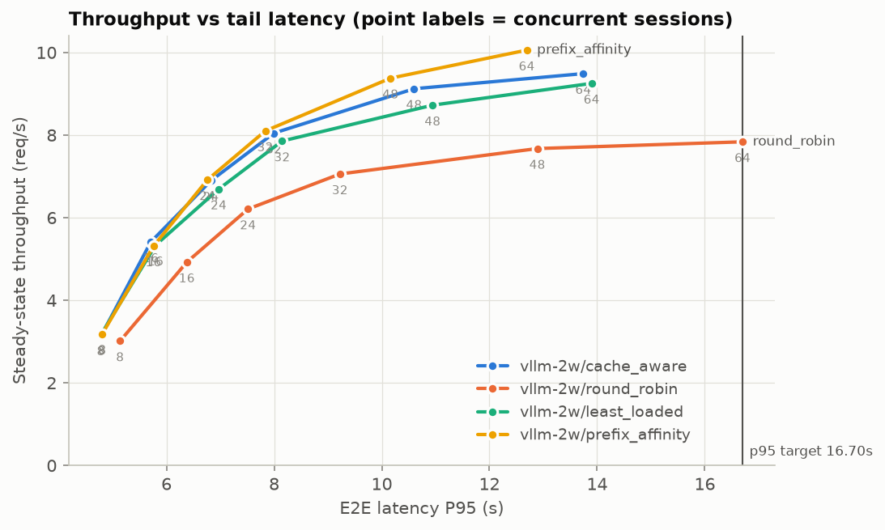
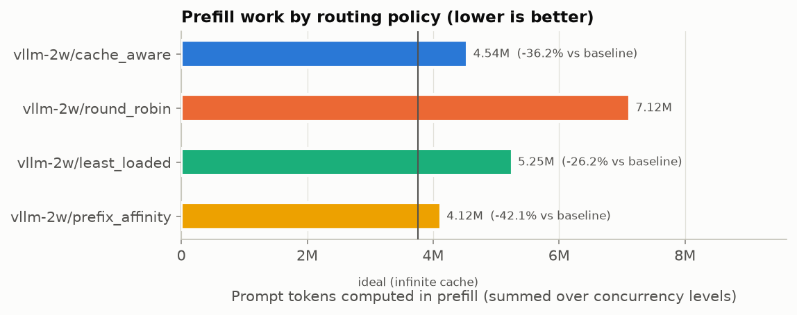
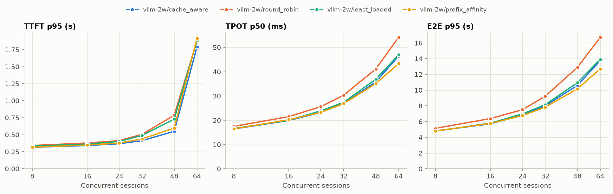
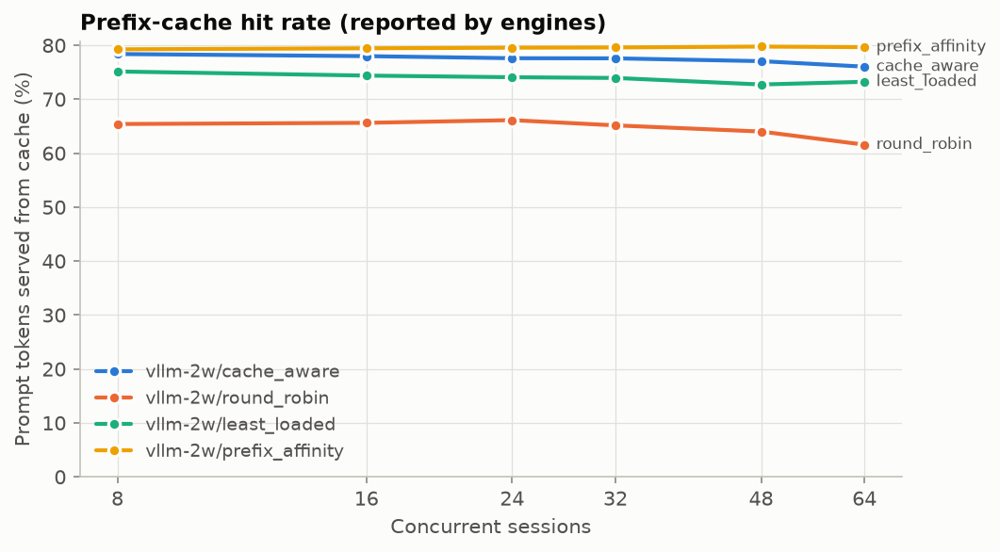
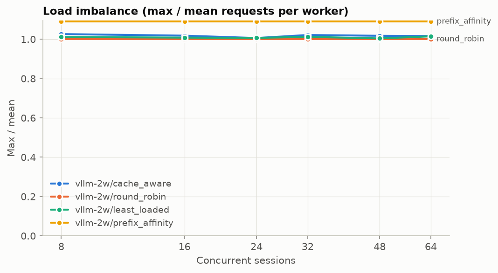
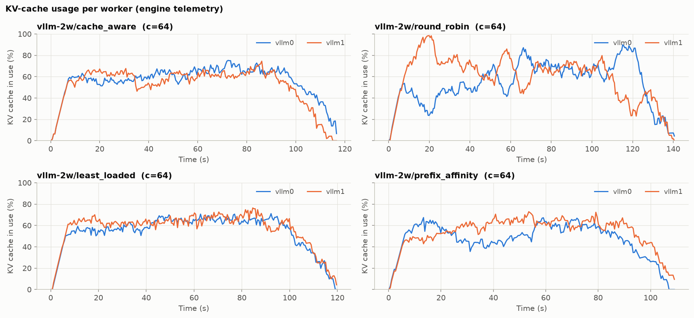
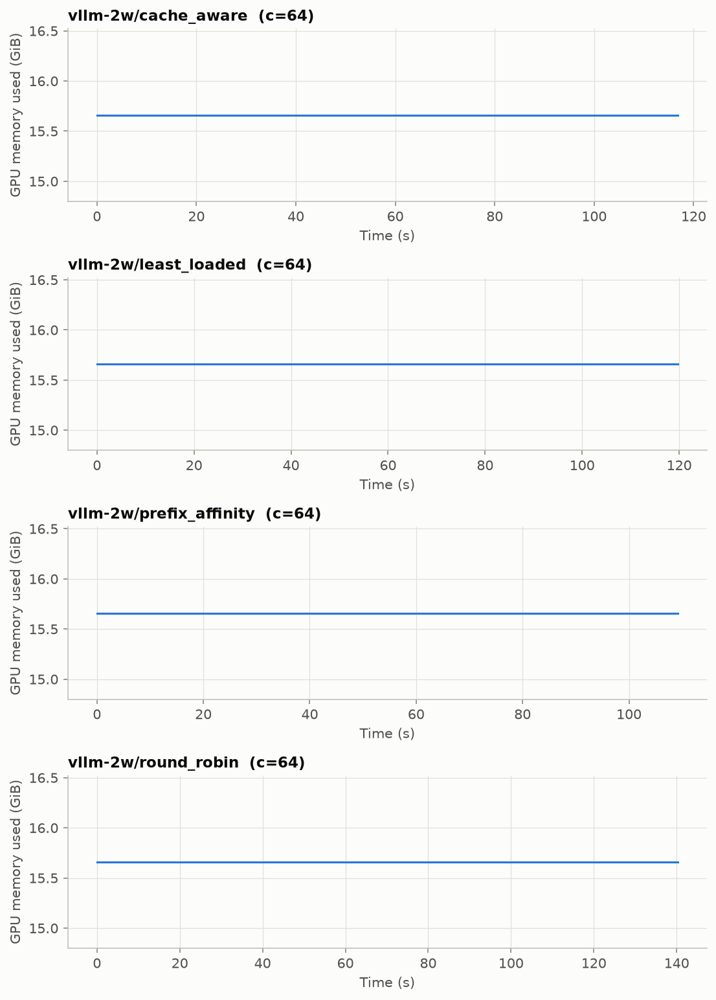

# KV-cache-aware routing benchmark report

Generated 2026-11-08 22:46 from: `results/vllm/20261108-233332`

- Labels compared: `vllm-2w/cache_aware`, `vllm-2w/least_loaded`, `vllm-2w/prefix_affinity`, `vllm-2w/round_robin`
- Baseline: `vllm-2w/round_robin`
- Concurrency levels: [8, 16, 24, 32, 48, 64]; repeats per point: 3
- Trace: 1000 prompts in 369 conversations; mean prompt 18,047 chars (p95 24,909); max achievable prefix reuse 81.3% of prompt characters

## Headline numbers

**Prefill work** (summed over all concurrency levels, mean across repeats):

| label | prompt tokens | computed prefill tokens | hit rate | ideal (∞ cache) | redundant | total prefill Δ vs baseline | redundant prefill Δ vs baseline |
|---|---:|---:|---:|---:|---:|---:|---:|
| `vllm-2w/cache_aware` | 20146326 | 4543942 | 77.4% | 3762600 | 781342 | 36.2% | 76.7% |
| `vllm-2w/round_robin` | 20146326 | 7120961 | 64.7% | 3762600 | 3358361 | 0.0% | 0.0% |
| `vllm-2w/least_loaded` | 20146326 | 5253691 | 73.9% | 3762600 | 1491091 | 26.2% | 55.6% |
| `vllm-2w/prefix_affinity` | 20146326 | 4120593 | 79.5% | 3762600 | 357993 | 42.1% | 89.3% |

Positive Δ = less prefill work than the baseline. These are *token* counts; they are not GPU-time or latency reductions.

**Throughput at matched e2e p95 ≤ 16.703 s** (auto: the baseline’s tail latency at its highest concurrency level):

Read the *note* column before quoting a number: `lower bound` = the policy stayed under the target at every tested concurrency (true value is higher); `flat region` = the target falls where latency barely rises with load, so small latency differences become large throughput differences. Do not quote flat-region results; extend the concurrency sweep or pass `--slo-target` nearer saturation.

| label | throughput at target (req/s) | Δ vs baseline (mean curve) | Δ per repeat (mean ± 95% CI) | note |
|---|---:|---:|---:|---|
| `vllm-2w/cache_aware` | 9.49 | 21.1% | 21.2 ± 4.1% | lower bound: never reached target (add higher concurrency) |
| `vllm-2w/round_robin` | 7.84 | 0.0% | 0.0 ± 0.0% | ok |
| `vllm-2w/least_loaded` | 9.25 | 18.1% | 18.2 ± 3.2% | lower bound: never reached target (add higher concurrency) |
| `vllm-2w/prefix_affinity` | 10.06 | 28.3% | 28.5 ± 6.3% | lower bound: never reached target (add higher concurrency) |

## Latency and throughput by concurrency

Mean across repeats ± 95% CI half-width (when repeats > 1). TTFT/E2E in seconds, TPOT in milliseconds.

| label | conc | TTFT p50 | TTFT p95 | TPOT p50 (ms) | TPOT p95 (ms) | E2E p50 | E2E p95 | throughput (req/s) | output tok/s | hit rate | imbalance | errors |
|---|---:|---:|---:|---:|---:|---:|---:|---:|---:|---:|---:|---:|
| `vllm-2w/cache_aware` | 8 | 0.086 ± 0.022 | 0.316 ± 0.024 | 16.4 ± 0.1 | 19.2 ± 0.2 | 2.252 ± 0.027 | 4.808 ± 0.039 | 3.19 ± 0.03 | 450 | 78.4% | 1.03 | 0.00% |
| `vllm-2w/cache_aware` | 16 | 0.098 ± 0.026 | 0.341 ± 0.029 | 19.9 ± 0.1 | 23.0 ± 0.6 | 2.658 ± 0.085 | 5.711 ± 0.105 | 5.41 ± 0.05 | 743 | 78.0% | 1.02 | 0.00% |
| `vllm-2w/cache_aware` | 24 | 0.101 ± 0.041 | 0.368 ± 0.018 | 23.2 ± 0.3 | 28.0 ± 0.1 | 3.113 ± 0.051 | 6.828 ± 0.138 | 6.90 ± 0.11 | 935 | 77.6% | 1.01 | 0.00% |
| `vllm-2w/cache_aware` | 32 | 0.119 ± 0.039 | 0.413 ± 0.076 | 26.9 ± 0.4 | 32.4 ± 1.1 | 3.566 ± 0.058 | 7.996 ± 0.203 | 8.05 ± 0.07 | 1075 | 77.6% | 1.02 | 0.00% |
| `vllm-2w/cache_aware` | 48 | 0.143 ± 0.048 | 0.551 ± 0.199 | 35.8 ± 0.7 | 45.3 ± 0.3 | 4.703 ± 0.114 | 10.601 ± 0.089 | 9.12 ± 0.08 | 1195 | 77.1% | 1.02 | 0.00% |
| `vllm-2w/cache_aware` | 64 | 0.175 ± 0.047 | 1.791 ± 0.373 | 46.4 ± 0.6 | 57.7 ± 1.6 | 5.913 ± 0.111 | 13.744 ± 0.772 | 9.49 ± 0.12 | 1221 | 76.0% | 1.02 | 0.00% |
| `vllm-2w/round_robin` | 8 | 0.098 ± 0.017 | 0.342 ± 0.027 | 17.4 ± 0.1 | 20.2 ± 0.3 | 2.393 ± 0.029 | 5.139 ± 0.144 | 3.01 ± 0.02 | 425 | 65.4% | 1.00 | 0.00% |
| `vllm-2w/round_robin` | 16 | 0.114 ± 0.023 | 0.378 ± 0.058 | 21.5 ± 0.2 | 26.8 ± 0.7 | 2.898 ± 0.057 | 6.380 ± 0.131 | 4.93 ± 0.11 | 677 | 65.6% | 1.00 | 0.00% |
| `vllm-2w/round_robin` | 24 | 0.124 ± 0.039 | 0.414 ± 0.025 | 25.6 ± 0.3 | 31.9 ± 0.8 | 3.465 ± 0.049 | 7.516 ± 0.215 | 6.21 ± 0.12 | 844 | 66.1% | 1.00 | 0.00% |
| `vllm-2w/round_robin` | 32 | 0.144 ± 0.039 | 0.506 ± 0.037 | 30.3 ± 0.7 | 40.8 ± 2.9 | 4.045 ± 0.127 | 9.223 ± 0.212 | 7.06 ± 0.02 | 947 | 65.2% | 1.00 | 0.00% |
| `vllm-2w/round_robin` | 48 | 0.189 ± 0.059 | 0.786 ± 0.164 | 41.1 ± 0.6 | 59.2 ± 8.3 | 5.511 ± 0.221 | 12.890 ± 1.107 | 7.67 ± 0.21 | 1024 | 64.0% | 1.00 | 0.00% |
| `vllm-2w/round_robin` | 64 | 0.275 ± 0.086 | 1.879 ± 0.627 | 54.2 ± 3.7 | 81.0 ± 16.7 | 7.070 ± 0.331 | 16.703 ± 2.339 | 7.84 ± 0.33 | 1029 | 61.6% | 1.00 | 0.00% |
| `vllm-2w/least_loaded` | 8 | 0.087 ± 0.022 | 0.333 ± 0.012 | 16.6 ± 0.1 | 19.3 ± 0.8 | 2.291 ± 0.055 | 4.781 ± 0.090 | 3.16 ± 0.00 | 445 | 75.1% | 1.01 | 0.00% |
| `vllm-2w/least_loaded` | 16 | 0.101 ± 0.025 | 0.363 ± 0.015 | 20.0 ± 0.3 | 23.8 ± 0.9 | 2.715 ± 0.054 | 5.800 ± 0.130 | 5.34 ± 0.03 | 729 | 74.4% | 1.01 | 0.00% |
| `vllm-2w/least_loaded` | 24 | 0.107 ± 0.030 | 0.401 ± 0.069 | 23.9 ± 0.3 | 28.5 ± 1.9 | 3.225 ± 0.067 | 6.971 ± 0.167 | 6.69 ± 0.12 | 903 | 74.1% | 1.01 | 0.00% |
| `vllm-2w/least_loaded` | 32 | 0.122 ± 0.039 | 0.490 ± 0.162 | 27.4 ± 0.3 | 33.8 ± 1.0 | 3.674 ± 0.114 | 8.149 ± 0.114 | 7.86 ± 0.19 | 1047 | 73.9% | 1.01 | 0.00% |
| `vllm-2w/least_loaded` | 48 | 0.156 ± 0.051 | 0.729 ± 0.115 | 36.9 ± 0.9 | 47.3 ± 5.0 | 4.928 ± 0.115 | 10.945 ± 0.030 | 8.72 ± 0.25 | 1145 | 72.7% | 1.00 | 0.00% |
| `vllm-2w/least_loaded` | 64 | 0.204 ± 0.065 | 1.886 ± 0.152 | 46.9 ± 0.6 | 59.7 ± 2.9 | 6.116 ± 0.121 | 13.899 ± 0.632 | 9.25 ± 0.18 | 1187 | 73.2% | 1.01 | 0.00% |
| `vllm-2w/prefix_affinity` | 8 | 0.086 ± 0.026 | 0.317 ± 0.033 | 16.4 ± 0.1 | 19.5 ± 0.1 | 2.276 ± 0.026 | 4.803 ± 0.025 | 3.18 ± 0.01 | 449 | 79.3% | 1.09 | 0.00% |
| `vllm-2w/prefix_affinity` | 16 | 0.098 ± 0.031 | 0.349 ± 0.049 | 20.2 ± 0.2 | 24.9 ± 0.6 | 2.724 ± 0.011 | 5.760 ± 0.230 | 5.31 ± 0.01 | 734 | 79.4% | 1.09 | 0.00% |
| `vllm-2w/prefix_affinity` | 24 | 0.108 ± 0.027 | 0.378 ± 0.040 | 23.2 ± 0.1 | 28.5 ± 0.3 | 3.119 ± 0.015 | 6.762 ± 0.123 | 6.92 ± 0.01 | 938 | 79.6% | 1.09 | 0.00% |
| `vllm-2w/prefix_affinity` | 32 | 0.117 ± 0.040 | 0.439 ± 0.008 | 26.8 ± 0.3 | 33.1 ± 0.6 | 3.586 ± 0.029 | 7.836 ± 0.136 | 8.10 ± 0.01 | 1086 | 79.6% | 1.09 | 0.00% |
| `vllm-2w/prefix_affinity` | 48 | 0.146 ± 0.039 | 0.598 ± 0.107 | 35.1 ± 0.6 | 43.5 ± 0.9 | 4.583 ± 0.077 | 10.161 ± 0.370 | 9.38 ± 0.07 | 1230 | 79.8% | 1.09 | 0.00% |
| `vllm-2w/prefix_affinity` | 64 | 0.186 ± 0.045 | 1.919 ± 0.222 | 43.3 ± 0.6 | 56.1 ± 0.8 | 5.593 ± 0.030 | 12.694 ± 0.210 | 10.06 ± 0.02 | 1293 | 79.7% | 1.09 | 0.00% |

## Prefill work by concurrency

| label | conc | computed prefill tokens | hit rate | total Δ vs baseline | redundant Δ vs baseline |
|---|---:|---:|---:|---:|---:|
| `vllm-2w/cache_aware` | 8 | 725806 | 78.4% | 37.5% | 81.5% |
| `vllm-2w/cache_aware` | 16 | 738974 | 78.0% | 36.0% | 78.8% |
| `vllm-2w/cache_aware` | 24 | 751924 | 77.6% | 33.9% | 75.5% |
| `vllm-2w/cache_aware` | 32 | 752638 | 77.6% | 35.7% | 76.9% |
| `vllm-2w/cache_aware` | 48 | 770148 | 77.1% | 36.3% | 75.4% |
| `vllm-2w/cache_aware` | 64 | 804452 | 76.0% | 37.6% | 73.2% |
| `vllm-2w/least_loaded` | 8 | 834516 | 75.1% | 28.1% | 61.2% |
| `vllm-2w/least_loaded` | 16 | 859993 | 74.4% | 25.5% | 55.8% |
| `vllm-2w/least_loaded` | 24 | 870286 | 74.1% | 23.5% | 52.3% |
| `vllm-2w/least_loaded` | 32 | 874734 | 73.9% | 25.2% | 54.4% |
| `vllm-2w/least_loaded` | 48 | 915406 | 72.7% | 24.2% | 50.4% |
| `vllm-2w/least_loaded` | 64 | 898756 | 73.2% | 30.3% | 59.0% |
| `vllm-2w/prefix_affinity` | 8 | 696505 | 79.3% | 40.0% | 87.0% |
| `vllm-2w/prefix_affinity` | 16 | 690249 | 79.4% | 40.2% | 88.0% |
| `vllm-2w/prefix_affinity` | 24 | 686404 | 79.6% | 39.6% | 88.4% |
| `vllm-2w/prefix_affinity` | 32 | 684937 | 79.6% | 41.5% | 89.3% |
| `vllm-2w/prefix_affinity` | 48 | 679497 | 79.8% | 43.8% | 91.0% |
| `vllm-2w/prefix_affinity` | 64 | 683001 | 79.7% | 47.1% | 91.6% |
| `vllm-2w/round_robin` | 8 | 1161444 | 65.4% | 0.0% | 0.0% |
| `vllm-2w/round_robin` | 16 | 1154094 | 65.6% | 0.0% | 0.0% |
| `vllm-2w/round_robin` | 24 | 1137268 | 66.1% | 0.0% | 0.0% |
| `vllm-2w/round_robin` | 32 | 1169870 | 65.2% | 0.0% | 0.0% |
| `vllm-2w/round_robin` | 48 | 1208212 | 64.0% | 0.0% | 0.0% |
| `vllm-2w/round_robin` | 64 | 1290073 | 61.6% | 0.0% | 0.0% |

## Metric definitions

- **TTFT**: request sent → first non-empty token received (client-side, includes routing and queueing).
- **TPOT**: (E2E − TTFT) / (completion tokens − 1).
- **E2E**: request sent → final chunk received.
- **Throughput**: completed requests per second between the 10th and 90th percentile completion times (excludes closed-loop ramp-up and drain).
- **Computed prefill tokens**: Σ (prompt_tokens − cached_tokens) using engine-reported `usage.prompt_tokens_details.cached_tokens` (prefill worker's usage in disaggregated mode).
- **Ideal prefill**: distinct prefix chunks in the trace (what one infinite cache would compute), converted to tokens with the measured tokens/char ratio. **Redundant** = computed − ideal.
- **Matched-latency throughput**: highest throughput (measured or linearly interpolated between adjacent concurrency points) whose tail latency is ≤ the target.
- **Load imbalance**: max / mean requests handled per worker (1.0 = perfectly even).
