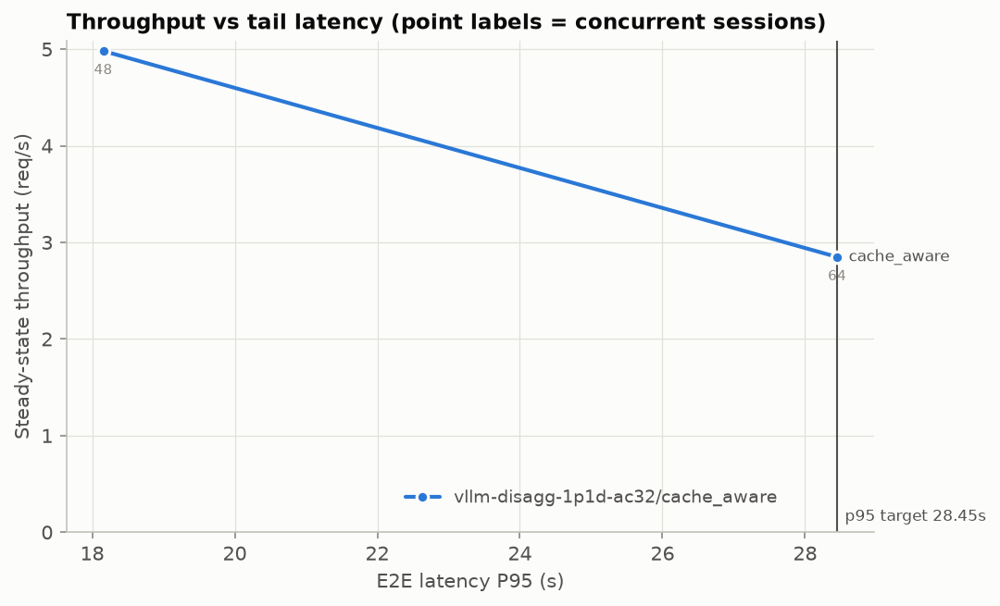
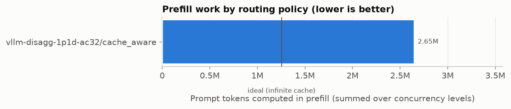
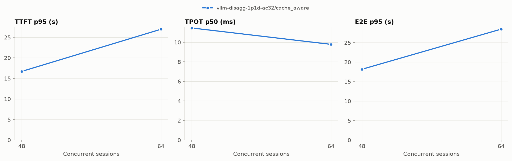
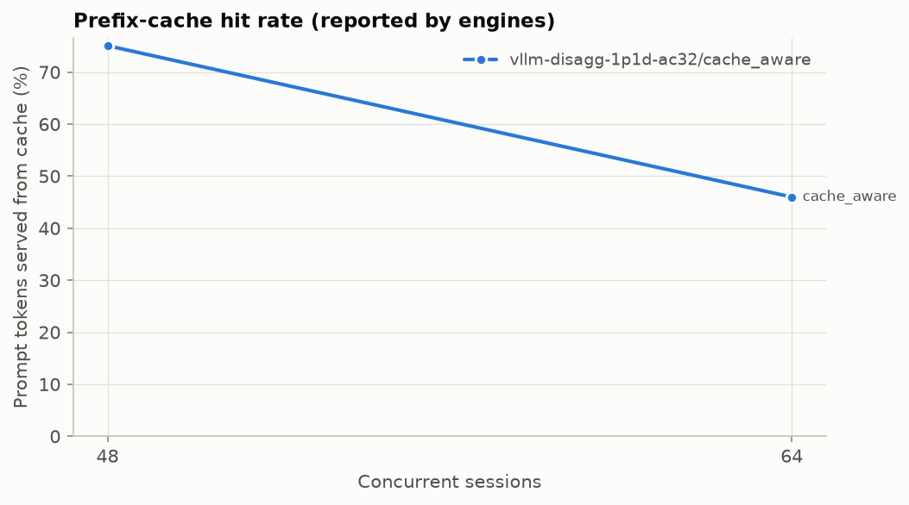
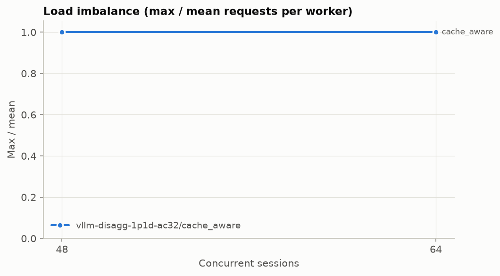
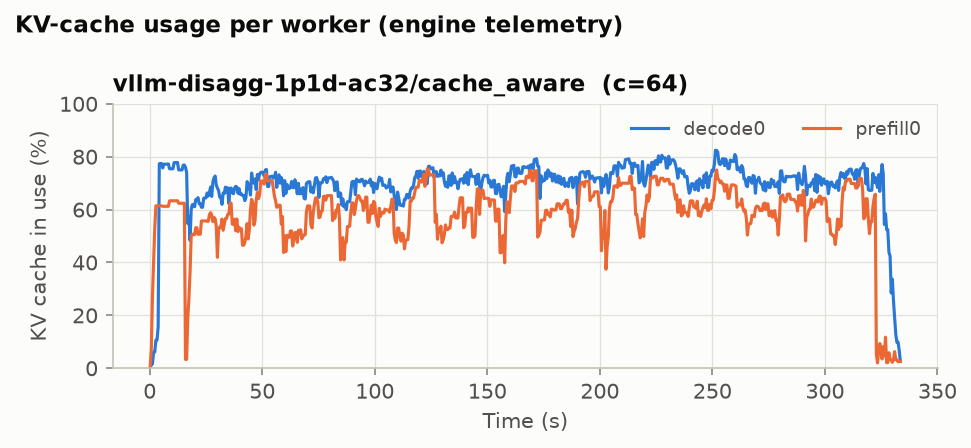
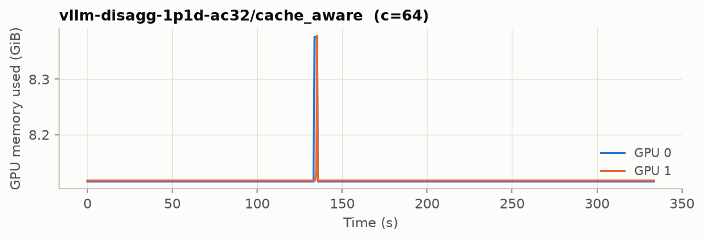

# KV-cache-aware routing benchmark report

Generated 2026-11-11 05:42 from: `results/vllm_disagg_ac/20261111-052406`

- Labels compared: `vllm-disagg-1p1d-ac32/cache_aware`
- Baseline: `vllm-disagg-1p1d-ac32/cache_aware`
- Concurrency levels: [48, 64]; repeats per point: 2
- Trace: 1000 prompts in 369 conversations; mean prompt 18,047 chars (p95 24,909); max achievable prefix reuse 81.3% of prompt characters

## Headline numbers

**Prefill work** (summed over all concurrency levels, mean across repeats):

| label | prompt tokens | computed prefill tokens | hit rate | ideal (∞ cache) | redundant | total prefill Δ vs baseline | redundant prefill Δ vs baseline |
|---|---:|---:|---:|---:|---:|---:|---:|
| `vllm-disagg-1p1d-ac32/cache_aware` | 6715442 | 2650594 | 60.5% | 1254200 | 1396394 | 0.0% | 0.0% |

Positive Δ = less prefill work than the baseline. These are *token* counts; they are not GPU-time or latency reductions.

**Throughput at matched e2e p95 ≤ 28.450 s** (auto: the baseline’s tail latency at its highest concurrency level):

Read the *note* column before quoting a number: `lower bound` = the policy stayed under the target at every tested concurrency (true value is higher); `flat region` = the target falls where latency barely rises with load, so small latency differences become large throughput differences. Do not quote flat-region results; extend the concurrency sweep or pass `--slo-target` nearer saturation.

| label | throughput at target (req/s) | Δ vs baseline (mean curve) | Δ per repeat (mean ± 95% CI) | note |
|---|---:|---:|---:|---|
| `vllm-disagg-1p1d-ac32/cache_aware` | 4.98 | 0.0% | 0.0 ± 0.0% | ok |

## Latency and throughput by concurrency

Mean across repeats ± 95% CI half-width (when repeats > 1). TTFT/E2E in seconds, TPOT in milliseconds.

| label | conc | TTFT p50 | TTFT p95 | TPOT p50 (ms) | TPOT p95 (ms) | E2E p50 | E2E p95 | throughput (req/s) | output tok/s | hit rate | imbalance | errors |
|---|---:|---:|---:|---:|---:|---:|---:|---:|---:|---:|---:|---:|
| `vllm-disagg-1p1d-ac32/cache_aware` | 48 | 4.924 ± 4.413 | 16.704 ± 4.775 | 11.5 ± 0.8 | 15.8 ± 2.4 | 7.270 ± 4.845 | 18.156 ± 3.591 | 4.98 ± 1.91 | 700 | 75.1% | 1.00 | 0.00% |
| `vllm-disagg-1p1d-ac32/cache_aware` | 64 | 20.685 ± 3.930 | 26.964 ± 2.000 | 9.8 ± 0.4 | 15.1 ± 12.6 | 22.034 ± 3.227 | 28.450 ± 1.596 | 2.85 ± 0.05 | 424 | 46.0% | 1.00 | 0.00% |

## Prefill work by concurrency

| label | conc | computed prefill tokens | hit rate | total Δ vs baseline | redundant Δ vs baseline |
|---|---:|---:|---:|---:|---:|
| `vllm-disagg-1p1d-ac32/cache_aware` | 48 | 836881 | 75.1% | 0.0% | 0.0% |
| `vllm-disagg-1p1d-ac32/cache_aware` | 64 | 1813713 | 46.0% | 0.0% | 0.0% |

## Metric definitions

- **TTFT**: request sent → first non-empty token received (client-side, includes routing and queueing).
- **TPOT**: (E2E − TTFT) / (completion tokens − 1).
- **E2E**: request sent → final chunk received.
- **Throughput**: completed requests per second between the 10th and 90th percentile completion times (excludes closed-loop ramp-up and drain).
- **Computed prefill tokens**: Σ (prompt_tokens − cached_tokens) using engine-reported `usage.prompt_tokens_details.cached_tokens` (prefill worker's usage in disaggregated mode).
- **Ideal prefill**: distinct prefix chunks in the trace (what one infinite cache would compute), converted to tokens with the measured tokens/char ratio. **Redundant** = computed − ideal.
- **Matched-latency throughput**: highest throughput (measured or linearly interpolated between adjacent concurrency points) whose tail latency is ≤ the target.
- **Load imbalance**: max / mean requests handled per worker (1.0 = perfectly even).
